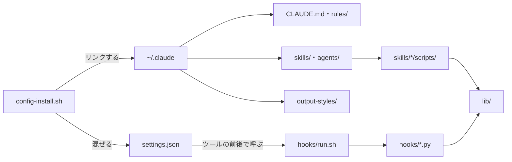
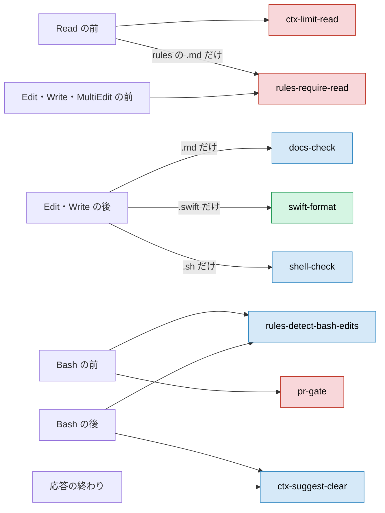
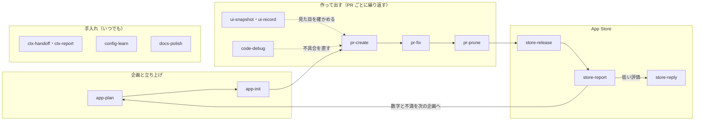

# claude-config

Claude Code の、全リポジトリに共通の決まり。`~/.claude` からシンボリックリンクで指して使う。


## 🗺️ 全体像

フォルダは、Claude が読むものと、決まりを守らせる仕組みに分かれる。

| フォルダ | 役割 | 読み手 |
| --- | --- | --- |
| `agents/` | 任せる相手 | Claude |
| `CLAUDE.md`・`rules/` | いつも、または当たるファイルを触る時に読み込まれる決まり | Claude |
| `docs/` | アプリの共通の構成と、claude-config を直す時の決まり | 人・Claude |
| `hooks/` | 決まりを守らせるフック | 仕組み |
| `lib/` | フックとスクリプトが共通で使う処理 | 仕組み |
| `output-styles/` | 報告の形 | Claude |
| `scripts/` | 入れる、検査する、文書を読むスクリプト | 人・仕組み |
| `settings/` | フックと許可の登録 | 仕組み |
| `skills/` | 手順と、手順が走らせるスクリプト | Claude |
| `tests/` | フックとスクリプトのテスト | 人・仕組み |

部品は、次のようにつながる。リポジトリだけの事実は、各リポジトリの CLAUDE.md と `.claude/rules/` に書く。



## 🚀 入れ方

claude-config を `~/Applications/AI/claude-config` に置く。次に [config-install.sh](scripts/config-install.sh) を走らせる。

> [!NOTE]
> `jq` と Python 3.9 以上が要る。`functools.cache` などを使うので、3.9 より古い Python では動かない。

```sh
~/Applications/AI/claude-config/scripts/config-install.sh
```

### config-install.sh がすること

スクリプトは、次の順に進む。

1. CLAUDE.md・rules・agents・スキル・output style を `~/.claude` からリンクする。同じ名前の実体があれば `NG` を出して止まる。
2. 壊れたスキルと output style のリンクを消す。
3. `settings/merge.jq` で `settings.json.new` を作り、差分を出す。入れる許可の一覧は `claude-config-allow.json.new` に書く。
4. 表示された `mv` のコマンドで、差分を確かめてから 2 つを置き換える。変わらない時は、許可の一覧だけをその場で置き換える。

> [!WARNING]
> フックはこの場所のファイルを読む。ほかの場所から実行すると `NG` を出して止まる。

### settings.json の混ぜ方

[settings/settings.json](settings/settings.json) は、settings.json に入れるフックと許可の元である。今の settings.json には、次のように混ぜる。

| 対象 | 混ぜ方 |
| --- | --- |
| 許可 | 足りないものだけを後ろに足す。前に入れて claude-config から消えた許可は外す |
| フック | claude-config の `hooks/` を呼ぶものだけを入れ替え、ほかのフックは残す |
| 表示 | `outputStyle` は、無い時だけ入れる |

## 📚 文書

アプリを作る時と、claude-config を直す時に読む文書と、写して使うひな形である。

| 文書 | 読む時 | 中身 |
| --- | --- | --- |
| [docs/architecture-ios.md](docs/architecture-ios.md) | 構成を決める時 | iOS アプリのフォルダ、依存の向き、テスト |
| [docs/development.md](docs/development.md) | claude-config を直す時 | 名前の付け方、スクリプトの書き方、共通の処理、テスト |
| [skills/app-init/templates/ios-app/](skills/app-init/templates/ios-app/) | `app-init` の時 | 新しい iOS アプリのひな形 |
| [skills/app-plan/templates/](skills/app-plan/templates/) | `app-plan` の時 | overview と roadmap のひな形 |

## 📏 決まり

CLAUDE.md はいつも読み込まれる。rules は、当たるファイルを読み書きする時だけ読み込まれる。

| ファイル | 読み込まれる時 | 決めること |
| --- | --- | --- |
| [CLAUDE.md](CLAUDE.md) | いつも | 言語、進め方、使う量、報告、ブランチ・コミット・PR |
| [rules/code-comments.md](rules/code-comments.md) | Swift・Kotlin・設定・シェル | コメントを書かない |
| [rules/docs-app.md](rules/docs-app.md) | `docs/`・`spec/`・README・CLAUDE.md | アプリの文書ごとの役割と、足す条件 |
| [rules/docs-claude.md](rules/docs-claude.md) | CLAUDE.md・rules・SKILL.md・agents | 飾らない形と、節の並び |
| [rules/docs-human.md](rules/docs-human.md) | README・`docs/`・`spec/` | 見出しの絵文字、バッジ、README の節の順 |
| [rules/docs-writing.md](rules/docs-writing.md) | `.md` | 運用、文、表現、守らせる仕組み |
| [rules/swift-core.md](rules/swift-core.md) | Swift | 宣言の置き方、改行、空行、ファイル |
| [rules/swift-test.md](rules/swift-test.md) | `Tests/`・`<名前>Tests/` の Swift | テストの空行と型の置き方 |
| [rules/swift-ui.md](rules/swift-ui.md) | 画面と部品のフォルダ、`*View.swift` | `View` の分け方、ビューの並べ方 |

## 🪝 フック

フックは、決まりを読まずに進めた時や、確認の前に出そうとした時に止める。検査のフックは `if` で拡張子を絞り、当たらないファイルではプロセスを起動しない。どれも [hooks/run.sh](hooks/run.sh) が名前で受け、`hooks/<名前>.py` を `python3 -I` で走らせる。

図の色は、フックの動きを表す。赤は道具を止め、青は止めずに知らせ、緑はファイルを整える。



| フック | 動き | 動く時 | 当たる時 |
| --- | --- | --- | --- |
| [ctx-limit-read](hooks/ctx-limit-read.py) | 🛑 止める | Read の前 | 30KB を超えるテキストを、`limit` を付けずに読む時 |
| [ctx-suggest-clear](hooks/ctx-suggest-clear.py) | 💬 知らせる | 応答の終わり、`gh pr create` の後 | 文脈が 20 万トークンを超える時と、PR を作った時 |
| [docs-check](hooks/docs-check.py) | 💬 知らせる | `.md` を Edit・Write した後。メモリのファイルは見ない | `.md` が `rules/docs-*.md` に合わない時 |
| [pr-gate](hooks/pr-gate.py) | 🛑 止める | Bash の前 | pr-create の `run-check.sh` の確認の前に、push や `gh pr create` をする時 |
| [rules-detect-bash-edits](hooks/rules-detect-bash-edits.py) | 💬 知らせる | Bash の前と後 | Bash でファイルを書き換えた時。git・make などは数えない |
| [rules-require-read](hooks/rules-require-read.py) | 🛑 止める | rules の `.md` の Read と、Edit・Write・MultiEdit の前 | 当たる rules を、この会話でまだ読まずに編集する時 |
| [shell-check](hooks/shell-check.py) | 💬 知らせる | `.sh` を Edit・Write した後 | `.sh` の `bash -n` と、変数の直後の全角 |
| [swift-format](hooks/swift-format.py) | 🧹 整える | `.swift` を Edit・Write した後。`.swiftformat` が無ければ動かない | `.swift` を、Mintfile の swiftformat で整える |

フックを止める時は、[環境変数](#-環境変数)の `CC_HOOKS_OFF` に名前を並べる。

```sh
CC_HOOKS_OFF="pr-gate,rules-require-read" claude
```

## 🧰 スキル

スキルは、Claude が要る時に自分で呼ぶ。人は `/<スキル>` で呼ぶ。名前の頭が分類を表す。

### 使う順

アプリの企画から公開の後まで、次の順に使う。手入れのスキルは、どの段でも使う。



### 一覧

呼ぶ人は、絵文字で分ける。

> [!IMPORTANT]
> pr-create・store-release・store-reply は外に出す操作を含む。人が言葉で頼んだ時だけ呼び、外に出す前に承認を得る。

| スキル | 呼ぶ人 | すること |
| --- | --- | --- |
| [app-init](skills/app-init/SKILL.md) | 🤝 人と Claude | ひな形から、ビルドとテストが通るアプリのリポジトリを作る |
| [app-plan](skills/app-plan/SKILL.md) | 🤝 人と Claude | 競合のレビューの不満を集め、overview と roadmap の下書きを作る |
| [code-debug](skills/code-debug/SKILL.md) | 🤝 人と Claude | 再現・3 つの仮説・検証で原因を確かめ、承認された直し方と再現テストを入れる |
| [config-learn](skills/config-learn/SKILL.md) | 🤝 人と Claude | 繰り返した手直しとフックの回数から、決まりの改定案を出す |
| [ctx-handoff](skills/ctx-handoff/SKILL.md) | 🤝 人と Claude | 区切る前に、続きに要ることを `.claude/handoff.md` に書く |
| [ctx-report](skills/ctx-report/SKILL.md) | 🤝 人と Claude | 月ごとに、トークンを多く使った作業を表にする |
| [docs-polish](skills/docs-polish/SKILL.md) | 🤝 人と Claude | 文字だけが続く節を見つけ、表・図・絵文字で見やすくする案を見本付きで出す |
| [pr-create](skills/pr-create/SKILL.md) | 🙋 人が頼んだ時だけ | 差分の大きさに合わせた確認とレビューを通して PR を作る |
| [pr-fix](skills/pr-fix/SKILL.md) | 🤝 人と Claude | 落ちた CI と未解決の指摘を直し、push し直す |
| [pr-prune](skills/pr-prune/SKILL.md) | 🤝 人と Claude | マージされた PR を main に反映し、ワークツリーを片付ける |
| [store-release](skills/store-release/SKILL.md) | 🙋 人が頼んだ時だけ | 申告・掲載情報・スクリーンショットを確かめ、アーカイブを送る |
| [store-reply](skills/store-reply/SKILL.md) | 🙋 人が頼んだ時だけ | 返信していない低い評価のレビューに返信案を書き、承認された案を送る |
| [store-report](skills/store-report/SKILL.md) | 🤝 人と Claude | 全アプリの月ごとのダウンロード・収益・評価を表にする |
| [ui-record](skills/ui-record/SKILL.md) | 🧠 Claude だけ | シミュレーターを録画し、確かめたい場面のコマを並べる |
| [ui-snapshot](skills/ui-snapshot/SKILL.md) | 🧠 Claude だけ | SwiftUI の画面をテストとして描き、場合ごとの PNG にする |

## 👷 エージェント

エージェントは、仕事の重さに合わせてモデルを分ける。

| エージェント | モデル | 任せること |
| --- | --- | --- |
| [debugger](agents/debugger.md) | Opus | 仮説ごとに裏付けと反証を集めて返す。書き換えない |
| [explorer](agents/explorer.md) | Haiku | 場所と事実を探して短く返す。書き換えない |
| [implementer](agents/implementer.md) | Sonnet | 方針の決まった実装、削除、名前の変更、文書の書き換え |
| [reviewer](agents/reviewer.md) | Opus | 差分を読み、マージすると困る所を 5 件まで返す |
| [tester](agents/tester.md) | Sonnet | 正常・異常・境界のテストを書いて通す。本体は直さない |

## 🖥️ 表示

Claude の報告の形をそろえる。config-install.sh が settings.json に入れる。

| 設定 | ファイル | 出すもの |
| --- | --- | --- |
| `outputStyle` | [output-styles/report.md](output-styles/report.md) | 結論を先に書き、表と状態の印で組む日本語の報告 |

## 🔧 環境変数

フックとスクリプトの動きは、次の環境変数で変えられる。claude-config だけの変数は、`CC_` と分類で始める。

| 変数 | 使う所 | 中身 |
| --- | --- | --- |
| `ASC_ISSUER_ID` ほか `ASC_*` | store-reply、store-report | App Store Connect API のキー |
| `CC_APPS_DIR` | app-init、store-reply、store-report | アプリのリポジトリの置き場所 |
| `CC_HOOKS_OFF` | hooks/run.sh、rules-detect-bash-edits | 空白・カンマ・タブで区切った名前のフックを動かさない。hooks/ に無い名前は stderr で知らせる |
| `CC_PROJECTS_DIR` | config-learn、ctx-report | 会話の記録の置き場所 |
| `CC_STORE_ARCHIVE_ONLY=1` | store-release | アーカイブだけを作り、送らない |
| `CC_STORE_EXPORT=export` | store-release | 送らずに IPA を書き出す |
| `CC_UI_DEVICE` | ui-snapshot | 描くシミュレーターの UDID |

## 📜 スクリプト

入れる時、確かめる時、文書を読む時に、次のスクリプトを使う。

| スクリプト | 呼ぶ時 | すること |
| --- | --- | --- |
| [scripts/config-audit.py](scripts/config-audit.py) | `make audit` の時 | README の表・図・参照先と名前の食い違い、文書とスクリプトの書き方の違反を見る |
| [scripts/config-install.sh](scripts/config-install.sh) | 入れる時 | `~/.claude` からリンクを張り、settings.json の案を作る |
| [scripts/docs-section.sh](scripts/docs-section.sh) | 文書を読む時 | 見出しの一覧か、指定した節だけを出す |

## 🧪 確かめ方

claude-config を変えたら、`make verify` を通す。

> [!IMPORTANT]
> CI は置かない。PR は、Claude が pr-create の確認で `make verify` を通してから作る。

| コマンド | 確かめること |
| --- | --- |
| `make verify` | `make audit` と `make test` を順に走らせる |
| `make audit` | config-audit.py で、文書と名前と書き方の決まり |
| `make test` | `tests/*.sh` の全部で、フックとスクリプトの振る舞い。1 本ずつの中身は [テスト](docs/development.md#-テスト) にある |
| `make test-<対象>` | `tests/<対象>.sh` の 1 本だけ |
