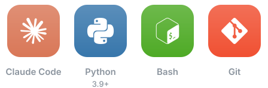
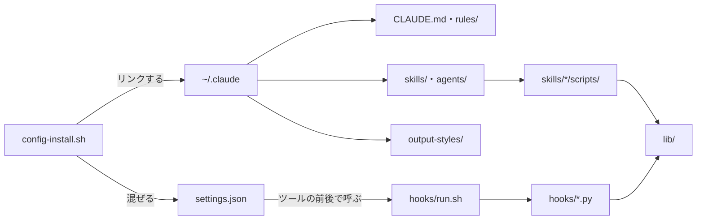

# claude-config

Claude Code の、全リポジトリに共通の決まり。`~/.claude` からシンボリックリンクで指して使う。



## ✨ 機能

| 部品 | できること | 一覧 |
| --- | --- | --- |
| 決まり | 文書・Swift・報告の書き方を、当たるファイルを触る時に読み込ませる | [components.md](docs/components.md#-決まり) |
| フック | 決まりを読まずに進めた時や、確認の前に出そうとした時に止める | [components.md](docs/components.md#-フック) |
| スキル | 企画・PR・App Store・手入れを、決まった手順で進める | [skills.md](docs/skills.md) |
| エージェント | 探す・作る・確かめる仕事を、重さに合うモデルに任せる | [components.md](docs/components.md#-エージェント) |
| ひな形 | ビルドとテストが通る iOS アプリのリポジトリを作る | [ios-app](skills/app-init/templates/ios-app/) |

## 🗺️ 全体像



| フォルダ | 役割 | 読み手 |
| --- | --- | --- |
| `agents/` | 任せる相手 | Claude |
| `CLAUDE.md`・`rules/` | いつも、または当たるファイルを触る時に読み込まれる決まり | Claude |
| `docs/` | アプリの共通の構成と、claude-config を直す時の決まり | 人・Claude |
| `hooks/` | 決まりを守らせるフック | 仕組み |
| `lib/` | フックとスクリプトが共通で使う処理 | 仕組み |
| `output-styles/` | 報告の形 | Claude |
| `scripts/` | 入れる、検査する、文書を読むスクリプト | 人・仕組み |
| `settings/` | フックと許可の登録 | 仕組み |
| `skills/` | 手順と、手順が走らせるスクリプト | Claude |
| `tests/` | フックとスクリプトのテスト | 人・仕組み |

## 💻 実行環境

| 道具 | 版 |
| --- | --- |
| Claude Code | 最新 |
| Python | 3.9 以上 |
| jq | 最新 |
| 置き場所 | `~/Applications/AI/claude-config` |

## 🚀 入れ方

```sh
git clone https://github.com/yossibank/claude-config ~/Applications/AI/claude-config
~/Applications/AI/claude-config/scripts/config-install.sh
```

## 📚 文書

| 文書 | 読む時 | 中身 |
| --- | --- | --- |
| [docs/components.md](docs/components.md) | 部品を知る時 | 決まり・フック・エージェント・スクリプト・環境変数 |
| [docs/skills.md](docs/skills.md) | スキルを選ぶ時 | スキルを使う順と一覧 |
| [docs/install.md](docs/install.md) | 入れる時 | config-install.sh がすること、settings.json の混ぜ方 |
| [docs/architecture-ios.md](docs/architecture-ios.md) | 構成を決める時 | iOS アプリのフォルダ、依存の向き、テスト |
| [docs/architecture-ios-naming.md](docs/architecture-ios-naming.md) | ファイルを足す・名前を付ける時 | iOS アプリのフォルダとファイルの名前、迷いやすい置き場所 |
| [docs/development.md](docs/development.md) | claude-config を直す時 | 名前の付け方・スクリプトの書き方・共通の処理・足し方 |
| [docs/testing.md](docs/testing.md) | claude-config を確かめる時 | make のコマンド・テストの置き方 |
| [docs/improvements.md](docs/improvements.md) | claude-config を調べ直す時 | まだ直していない改善（バグ・処理・テスト）と、直さないと決めたこと |
| [docs/improvements-docs.md](docs/improvements-docs.md) | claude-config を調べ直す時 | まだ直していない文書の改善と、名前と並び |
