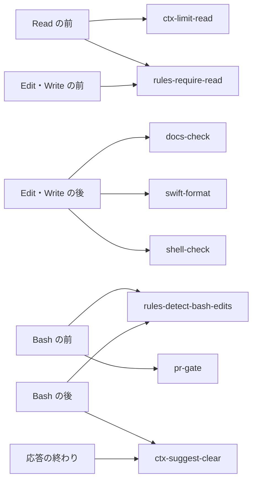
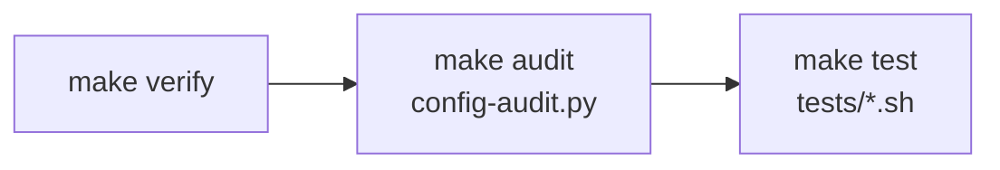

# claude-config

Claude Code の、全リポジトリに共通の決まり。`~/.claude` からシンボリックリンクで指して使う。


## 🗺️ 全体像

フォルダは、Claude が読むものと、仕組みと、ひな形に分かれる。

```text
claude-config/
├── CLAUDE.md
├── agents/
├── docs/
├── hooks/
├── lib/
├── rules/
├── scripts/
├── settings/
├── skills/
└── tests/
```

| フォルダ | 役割 | 読み手 |
| --- | --- | --- |
| `CLAUDE.md`・`rules/` | いつも、または当たるファイルを触る時に読み込まれる決まり | Claude |
| `agents/`・`skills/` | 任せる相手と、手順 | Claude |
| `hooks/`・`settings/` | 決まりを守らせるフックと、その登録 | 仕組み |
| `scripts/`・`tests/` | 入れる、検査する、確かめるスクリプト | 人・仕組み |
| `lib/` | フックとスクリプトが共通で使う処理 | 仕組み |
| `docs/` | アプリの共通の構成 | 人・Claude |

リポジトリだけの事実は、各リポジトリの CLAUDE.md と `.claude/rules/` に書く。

## 🚀 入れ方

claude-config を `~/Applications/AI/claude-config` に置く。次に [config-install.sh](scripts/config-install.sh) を走らせる。

> [!NOTE]
> `jq` と Python 3.9 以上が要る。`functools.cache` などを使うので、3.9 より古い Python では動かない。

```sh
~/Applications/AI/claude-config/scripts/config-install.sh
```

### config-install.sh がすること

スクリプトは、次の順に進む。

1. CLAUDE.md・rules・agents・各スキルを `~/.claude` からリンクする。
2. 壊れたスキルのリンクを消す。同じ名前の実体があれば `NG` を出して止まる。
3. `settings/merge.jq` で `settings.json.new` を作り、差分を出す。
4. 表示された `mv` のコマンドで、差分を確かめてから置き換える。

> [!WARNING]
> フックはこの場所のファイルを読む。ほかの場所から実行すると `NG` を出して止まる。

### settings.json の混ぜ方

[settings/settings.json](settings/settings.json) は、settings.json に入れるフックと許可の元である。今の settings.json には、次のように混ぜる。

> [!NOTE]
> - 許可：足りないものだけを後ろに足す。
> - フック：claude-config の `hooks/` を呼ぶものだけを入れ替え、ほかのフックは残す。

## 📚 文書

アプリを作る時に読む文書と、写して使うひな形である。

| 文書 | 読む時 | 中身 |
| --- | --- | --- |
| [docs/architecture-ios.md](docs/architecture-ios.md) | 構成を決める時 | iOS アプリのフォルダ、依存の向き、テスト |
| [skills/app-init/templates/ios-app/](skills/app-init/templates/ios-app/) | `app-init` の時 | 新しい iOS アプリのひな形 |
| [skills/app-plan/templates/](skills/app-plan/templates/) | `app-plan` の時 | overview と roadmap のひな形 |

## 📏 決まり

CLAUDE.md はいつも読み込まれる。rules は、当たるファイルを読み書きする時だけ読み込まれる。

| ファイル | 読み込まれる時 | 決めること |
| --- | --- | --- |
| [CLAUDE.md](CLAUDE.md) | いつも | 言語、進め方、使う量、報告、ブランチ・コミット・PR |
| [rules/code-comments.md](rules/code-comments.md) | Swift・Kotlin・設定・シェル | コメントを書かない |
| [rules/docs-app.md](rules/docs-app.md) | `docs/`・`spec/`・README・CLAUDE.md | アプリの文書ごとの役割と、足す条件 |
| [rules/docs-writing.md](rules/docs-writing.md) | `.md` | 文、表現、読み手ごとの形 |
| [rules/swift-core.md](rules/swift-core.md) | Swift | 宣言の置き方、改行、空行、ファイル |
| [rules/swift-test.md](rules/swift-test.md) | `Tests/`・`<名前>Tests/` の Swift | テストの空行と型の置き方 |
| [rules/swift-ui.md](rules/swift-ui.md) | 画面と部品のフォルダ、`*View.swift` | `View` の分け方、ビューの並べ方 |

## 🪝 フック

フックは、決まりを読まずに進めた時や、確認の前に出そうとした時に止める。どれも [hooks/run.sh](hooks/run.sh) が名前で受け、`hooks/<名前>.py` を `python3 -I` で走らせる。



| フック | 動く時 | 止める・返す時 |
| --- | --- | --- |
| [ctx-limit-read](hooks/ctx-limit-read.py) | Read の前 | 30KB を超えるテキストを、`limit` を付けずに読む時 |
| [ctx-suggest-clear](hooks/ctx-suggest-clear.py) | 応答の終わり、`gh pr create` の後 | 文脈が 20 万トークンを超える時と、PR を作った時 |
| [docs-check](hooks/docs-check.py) | Edit の後。メモリのファイルは見ない | `.md` が `rules/docs-writing.md` に合わない時 |
| [pr-gate](hooks/pr-gate.py) | Bash の前 | pr-create の `run-check.sh` の確認の前に、push や `gh pr create` をする時 |
| [rules-detect-bash-edits](hooks/rules-detect-bash-edits.py) | Bash の前と後 | Bash でファイルを書き換えた時。git・make などは数えない |
| [rules-require-read](hooks/rules-require-read.py) | Read・Edit の前 | 当たる rules を、この会話でまだ読まずに編集する時 |
| [shell-check](hooks/shell-check.py) | Edit の後 | `.sh` の `bash -n` と、変数の直後の全角 |
| [swift-format](hooks/swift-format.py) | Edit の後。`.swiftformat` が無ければ動かない | `.swift` を、Mintfile の swiftformat で整える |

フックを止める時は、[環境変数](#-環境変数)の `CLAUDE_HOOKS_OFF` に名前を並べる。

```sh
CLAUDE_HOOKS_OFF="pr-gate,rules-require-read" claude
```

## 🧰 スキル

スキルは、Claude が要る時に自分で呼ぶ。人は `/<スキル>` で呼ぶ。

> [!IMPORTANT]
> pr-create と store-release は外に出す操作を含む。人が言葉で頼んだ時だけ呼び、外に出す前に承認を得る。

### app：企画と立ち上げ

| スキル | 呼ぶ人 | すること |
| --- | --- | --- |
| [app-init](skills/app-init/SKILL.md) | 人・Claude | ひな形から、ビルドとテストが通るアプリのリポジトリを作る |
| [app-plan](skills/app-plan/SKILL.md) | 人・Claude | 競合のレビューの不満を集め、overview と roadmap の下書きを作る |

### config：claude-config の手入れ

| スキル | 呼ぶ人 | すること |
| --- | --- | --- |
| [config-learn](skills/config-learn/SKILL.md) | 人・Claude | 繰り返した手直しとフックの回数から、決まりの改定案を出す |

### ctx：文脈とトークン

| スキル | 呼ぶ人 | すること |
| --- | --- | --- |
| [ctx-handoff](skills/ctx-handoff/SKILL.md) | 人・Claude | 区切る前に、続きに要ることを `.claude/handoff.md` に書く |
| [ctx-report](skills/ctx-report/SKILL.md) | 人・Claude | 月ごとに、トークンを多く使った作業を表にする |

### pr：PR

| スキル | 呼ぶ人 | すること |
| --- | --- | --- |
| [pr-create](skills/pr-create/SKILL.md) | **人が頼んだ時だけ Claude** | 差分の大きさに合わせた確認とレビューを通して PR を作る |
| [pr-fix](skills/pr-fix/SKILL.md) | 人・Claude | 落ちた CI と未解決の指摘を直し、push し直す |
| [pr-prune](skills/pr-prune/SKILL.md) | 人・Claude | マージされた PR を main に反映し、ワークツリーを片付ける |

### store：App Store

| スキル | 呼ぶ人 | すること |
| --- | --- | --- |
| [store-release](skills/store-release/SKILL.md) | **人が頼んだ時だけ Claude** | 申告・掲載情報・スクリーンショットを確かめ、アーカイブを送る |
| [store-report](skills/store-report/SKILL.md) | 人・Claude | 全アプリの月ごとのダウンロード・収益・評価を表にする |

### ui：見た目と動き

| スキル | 呼ぶ人 | すること |
| --- | --- | --- |
| [ui-record](skills/ui-record/SKILL.md) | Claude | シミュレーターを録画し、確かめたい場面のコマを並べる |
| [ui-snapshot](skills/ui-snapshot/SKILL.md) | Claude | SwiftUI の画面をテストとして描き、場合ごとの PNG にする |

## 👷 エージェント

エージェントは、仕事の重さに合わせてモデルを分ける。

| エージェント | モデル | 任せること |
| --- | --- | --- |
| [explorer](agents/explorer.md) | Haiku | 場所と事実を探して短く返す。書き換えない |
| [implementer](agents/implementer.md) | Sonnet | 方針の決まった実装、削除、名前の変更、文書の書き換え |
| [reviewer](agents/reviewer.md) | Opus | 差分を読み、マージすると困る所を 5 件まで返す |

## 🏷️ 名前の付け方

名前は `<分類>-<すること>` にそろえる。フォルダの中を名前の順に並べると、分類ごとにまとまる。分類は、フォルダをまたいで同じ接頭語を使う。

| 対象 | 形 | 例 |
| --- | --- | --- |
| スキル | `<分類>-<すること>` | `pr-create`、`ctx-handoff` |
| フック | `<分類>-<すること>.py`。イベントは settings.json に書く | `docs-check.py`、`pr-gate.py` |
| rules | `<分類>-<範囲>.md` | `swift-core.md` |
| scripts | `<分類>-<すること>.sh`・`.py` | `docs-section.sh`、`config-audit.py` |
| スキルのスクリプト | 動詞を先に、`<すること>[-<対象>]` | `check-listing.py`、`create-worktree.sh` |
| エージェント | 役割の名詞（`-er`） | `explorer` |
| ひな形の印 | スクリプトが置き換える所は `__<名前>__`、人が書く所は `<中身>` | `__App__`、`<名前>` |

分類は、次の表から選ぶ。新しい分類が要る時は、行を足してから名前を付ける。

> [!IMPORTANT]
> config-audit が、この表に無い接頭語と、使う所の違う接頭語を `NG` にする。

| 接頭語 | 分類 | 使う所 |
| --- | --- | --- |
| `app-` | 企画・立ち上げ | skills |
| `code-` | コード全般 | rules |
| `config-` | claude-config 自体の手入れ | skills、scripts |
| `ctx-` | 文脈とトークンの管理 | skills、hooks |
| `docs-` | 文書 | rules、hooks、scripts |
| `pr-` | PR | skills、hooks |
| `rules-` | rules を読ませる | hooks |
| `shell-` | シェルスクリプト | hooks |
| `store-` | App Store への公開と数字 | skills |
| `swift-` | Swift | rules、hooks |
| `ui-` | 見た目と動きの確認 | skills |

スキルのスクリプトの頭の動詞は、次の表から選ぶ。表に無い動詞は config-audit が `NG` にするので、行を足してから名前を付ける。

| 動詞 | すること |
| --- | --- |
| `add`・`create` | 足す、作る |
| `collect`・`fetch`・`list`・`search` | 集める、取ってくる、並べる、探す |
| `check`・`classify`・`count`・`hash` | 確かめる、分ける、数える、指紋を取る |
| `record`・`render`・`take`・`tile`・`write` | 録る、描く、撮る、並べる、書く |
| `archive`・`prune`・`replace`・`route`・`run` | アーカイブを作る、片付ける、置き換える、振り分ける、走らせる |

## 🔧 環境変数

フックとスクリプトの動きは、次の環境変数で変えられる。

| 変数 | 使う所 | 中身 |
| --- | --- | --- |
| `CLAUDE_HOOKS_OFF` | hooks/run.sh、rules-detect-bash-edits | 空白・カンマ・タブで区切った名前のフックを動かさない。hooks/ に無い名前は stderr で知らせる |
| `CLAUDE_PROJECTS` | config-learn、ctx-report | 会話の記録の置き場所 |
| `APPS_DIR` | app-init、store-report | アプリのリポジトリの置き場所 |
| `DEVICE` | ui-snapshot | 描くシミュレーターの UDID |
| `ARCHIVE_ONLY=1` | store-release | アーカイブだけを作り、送らない |
| `EXPORT_DESTINATION=export` | store-release | 送らずに IPA を書き出す |
| `ASC_ISSUER_ID` ほか `ASC_*` | store-report | App Store Connect API のキー |

## 📜 スクリプト

入れる時と文書を読む時に、次のスクリプトを使う。`make verify` で走る config-audit は、[確かめ方](#-確かめ方)にある。

| スクリプト | 呼ぶ時 | すること |
| --- | --- | --- |
| [scripts/config-install.sh](scripts/config-install.sh) | 入れる時 | `~/.claude` からリンクを張り、settings.json の案を作る |
| [scripts/docs-section.sh](scripts/docs-section.sh) | 文書を読む時 | 見出しの一覧か、指定した節だけを出す |

フックとスクリプトが共通で使う処理は、`lib/` に置く。

| ファイル | 使う所 | 中身 |
| --- | --- | --- |
| [lib/hook_io.py](lib/hook_io.py) | 各フック | 入力の JSON、コマンドの区切り、止めたフックの判定、タイムアウト付きの git、状態ファイルの掃除 |
| [lib/hook_stops.py](lib/hook_stops.py) | 止めるフック、collect-corrections.py | フックが止める時の文の書き出し。config-learn も数えるのに使う |
| [lib/md_blocks.py](lib/md_blocks.py) | docs-check、rules-require-read、config-audit.py | Markdown の frontmatter とコードの囲みの見分け方 |
| [lib/transcripts.py](lib/transcripts.py) | collect-corrections.py、count-tokens.py、フック | 会話の記録の読み方 |
| [lib/months.py](lib/months.py) | 月を扱うスクリプト | 日本時間、月の形 |
| [lib/modules.py](lib/modules.py) | config-audit.py、write-report.py ほか | ファイルの場所から .py を読み込む |
| [lib/script_io.py](lib/script_io.py) | スキルの .py | `NG` を出して止める `fail` |
| [lib/app_store.py](lib/app_store.py) | fetch-reviews.py、search-apps.py、fetch-ratings.py | App Store の検索とレビューの読み方 |
| [lib/git.sh](lib/git.sh) | スキルの .sh | リポジトリの根、既定のブランチ、GitHub での書き込みの権限 |

### スクリプトの書き方

スクリプトは、読み込まれた時に何も実行せず、結果を同じ形で返す。`make verify` の config-audit が、外れた書き方を `NG` にする。

| 対象 | 決まり |
| --- | --- |
| Python | 処理は `main()` に入れ、末尾を `if __name__ == "__main__":` にする |
| 結果 | stdout に `OK`・`NG` で始まる行で出す。失敗したら終了コード 1 で終える |
| 引数 | 足りない時は `[[ $# -ge N ]]` で確かめ、`NG` を出す。`${N:?}` は使わない |
| 知らせ | 失敗ではない知らせは stderr に出す |
| フック | 終了コード 2 で返す文は stderr に、JSON で返すものは stdout に出す |
| 共通の処理 | フックとスクリプトの共通の処理は `lib/` に置き、`sys.path.insert` で読む |

## 🧪 確かめ方

claude-config を変えたら、`make verify` を通す。`make audit` と `make test` を順に走らせる。



| コマンド | 確かめること |
| --- | --- |
| [scripts/config-audit.py](scripts/config-audit.py) | README の表・参照先・名前と中身の食い違いと、文書とスクリプトの書き方の違反 |
| `tests/config-audit.sh` | わざと壊した写しで、config-audit が違反を見逃さないか |
| `tests/hooks.sh` | 作り物のリポジトリで、フックが止めるべき時に止めるか |
| `tests/config-learn.sh` | フックが止めた回数を、config-learn が数えられるか |
| `tests/docs-section.sh` | 見出しの一覧と節の出し方 |
| `tests/pr-create.sh` | 作業場所・PR の重さ・本文・出し方を決められるか。偽の gh と作り物のリポジトリで試す |
| `tests/pr-fix.sh` | 偽の gh で、直すものを集められるか |
| `tests/pr-prune.sh` | 偽の gh と作り物のリポジトリで、消してよいものだけを消すか |
| `tests/config-install.sh` | 一時の HOME で、入れ方がほかのフックと実体を残すか |
| `tests/app-init.sh` | ひな形の印を置き換えられるか |
| `tests/store-release.sh` | 掲載情報の字数と形を確かめられるか |
| `tests/ui-snapshot.sh` | パッケージにテストのターゲットを足せるか |

テストが共通で使う処理は、`tests/lib/` に置く。

| ファイル | 中身 |
| --- | --- |
| [tests/lib/assert.sh](tests/lib/assert.sh) | 一時のフォルダ、`OK`・`NG` の出し方、結果の数え方 |
| [tests/lib/fixtures.sh](tests/lib/fixtures.sh) | 作り物のリポジトリと、偽の gh |
