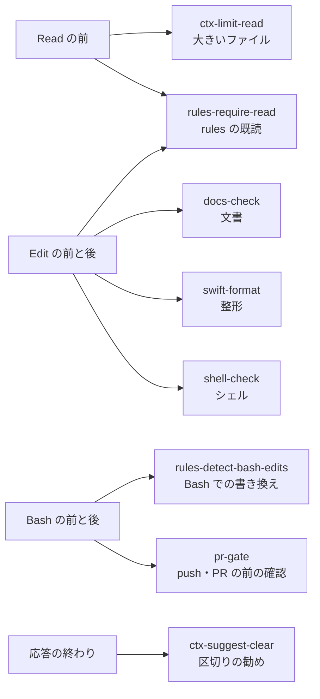

# claude-config

Claude Code の、全リポジトリに共通の決まり。`~/.claude` からシンボリックリンクで指して使う。


## 🗺️ 全体像

フォルダは、Claude が読むものと、仕組みと、ひな形に分かれる。

```text
claude-config/
├── CLAUDE.md
├── agents/
├── docs/
├── hooks/
├── lib/
├── rules/
├── scripts/
├── settings/
├── skills/
└── tests/
```

| フォルダ | 役割 | 読み手 |
| --- | --- | --- |
| `CLAUDE.md`・`rules/` | いつも、または当たるファイルを触る時に読み込まれる決まり | Claude |
| `agents/`・`skills/` | 任せる相手と、手順 | Claude |
| `hooks/`・`settings/` | 決まりを守らせるフックと、その登録 | 仕組み |
| `scripts/`・`tests/` | 入れる、検査する、確かめるスクリプト | 人・仕組み |
| `lib/` | フックとスクリプトが共通で使う処理 | 仕組み |
| `docs/` | アプリの共通の構成 | 人・Claude |

リポジトリだけの事実は、各リポジトリの CLAUDE.md と `.claude/rules/` に書く。

## 📏 決まり

CLAUDE.md はいつも読み込まれる。rules は、当たるファイルを読み書きする時だけ読み込まれる。

| ファイル | 読み込まれる時 | 決めること |
| --- | --- | --- |
| [CLAUDE.md](CLAUDE.md) | いつも | 言語、進め方、使う量、報告、ブランチ・コミット・PR |
| [rules/code-comments.md](rules/code-comments.md) | Swift・Kotlin・設定・シェル | コメントを書かない |
| [rules/docs-app.md](rules/docs-app.md) | `docs/`・`spec/`・README・CLAUDE.md | アプリの文書ごとの役割と、足す条件 |
| [rules/docs-writing.md](rules/docs-writing.md) | `.md` | 文、表現、読み手ごとの形 |
| [rules/swift-core.md](rules/swift-core.md) | Swift | 宣言の置き方、改行、空行、ファイル |
| [rules/swift-test.md](rules/swift-test.md) | `Tests/`・`<名前>Tests/` の Swift | テストの空行と型の置き方 |
| [rules/swift-ui.md](rules/swift-ui.md) | 画面と部品のフォルダ、`*View.swift` | `View` の分け方、ビューの並べ方 |
| [docs/architecture-ios.md](docs/architecture-ios.md) | 構成を決める時に読む | iOS アプリのフォルダ、依存の向き |
| [skills/app-init/templates/ios-app/](skills/app-init/templates/ios-app/) | `app-init` の時 | 新しい iOS アプリのひな形 |

## 🪝 フック

フックは、決まりを読まずに進めた時や、確認の前に出そうとした時に止める。どれも `hooks/run.sh` から呼ばれる。



| フック | 動く時 | 止める・返す時 | 止めない方法 |
| --- | --- | --- | --- |
| [ctx-limit-read](hooks/ctx-limit-read.py) | Read の前 | 30KB を超えるテキストを、範囲なしで読む時 | `limit` を付けて読む |
| [ctx-suggest-clear](hooks/ctx-suggest-clear.py) | 応答の終わり、PR の作成の後 | 文脈が 20 万トークンを超える時と、PR を作った時 | |
| [docs-check](hooks/docs-check.py) | Edit の後 | `.md` が `rules/docs-writing.md` に合わない時 | メモリのファイルは見ない |
| [pr-gate](hooks/pr-gate.py) | Bash の前 | pr-create の `run-check.sh` の確認の前に、push や `gh pr create` をする時 | `CLAUDE_HOOKS_OFF=pr-gate` |
| [rules-detect-bash-edits](hooks/rules-detect-bash-edits.py) | Bash の前と後 | Bash でファイルを書き換えた時。git・make などは数えない | |
| [rules-require-read](hooks/rules-require-read.py) | Read・Edit の前 | 当たる rules を、この会話でまだ読まずに編集する時 | `CLAUDE_HOOKS_OFF=rules-require-read` |
| [shell-check](hooks/shell-check.py) | Edit の後 | `.sh` の `bash -n` と、変数の直後の全角 | |
| [swift-format](hooks/swift-format.py) | Edit の後 | `.swift` を、Mintfile の swiftformat で整える | `.swiftformat` が無ければ動かない |

フックが共通で使う処理は、次のファイルにまとめてある。

| ファイル | 中身 |
| --- | --- |
| [hooks/run.sh](hooks/run.sh) | 名前で呼ばれ、`hooks/<名前>.py` を `python3 -I` で走らせる。無ければ `NG` を出す |
| [lib/hook_io.py](lib/hook_io.py) | 入力の JSON、タイムアウト付きの git、状態ファイルの掃除 |
| [lib/hook_stops.py](lib/hook_stops.py) | フックが止める時の文の書き出し。config-learn も数えるのに使う |
| [lib/git.sh](lib/git.sh) | スキルの sh が読む。リポジトリの根、既定のブランチ、GitHub での書き込みの権限 |

## 🧰 スキル

スキルは、Claude が要る時に自分で呼ぶ。人が `/` で呼んでもよい。

| スキル | 呼ぶ人 | すること |
| --- | --- | --- |
| [/app-init](skills/app-init/SKILL.md) | 人・Claude | ひな形から、ビルドとテストが通るアプリのリポジトリを作る |
| [/app-plan](skills/app-plan/SKILL.md) | 人・Claude | 競合のレビューの不満を集め、overview と roadmap の下書きを作る |
| [/config-learn](skills/config-learn/SKILL.md) | 人・Claude | 繰り返した手直しとフックの回数から、決まりの改定案を出す |
| [/ctx-handoff](skills/ctx-handoff/SKILL.md) | 人・Claude | 区切る前に、続きに要ることを `.claude/handoff.md` に書く |
| [/ctx-report](skills/ctx-report/SKILL.md) | 人・Claude | 月ごとに、トークンを多く使った作業を表にする |
| [/pr-create](skills/pr-create/SKILL.md) | 人が頼んだ時に Claude | 差分の大きさに合わせた確認とレビューを通して PR を作る |
| [/pr-fix](skills/pr-fix/SKILL.md) | 人・Claude | 落ちた CI と未解決の指摘を直し、push し直す |
| [/pr-prune](skills/pr-prune/SKILL.md) | 人・Claude | マージされた PR を main に反映し、ワークツリーを片付ける |
| [/store-release](skills/store-release/SKILL.md) | 人が頼んだ時に Claude | 申告・掲載情報・スクリーンショットを確かめ、アーカイブを送る |
| [/store-report](skills/store-report/SKILL.md) | 人・Claude | 全アプリの月ごとのダウンロード・収益・評価を表にする |
| [ui-record](skills/ui-record/SKILL.md) | Claude | シミュレーターを録画し、確かめたい場面のコマを並べる |
| [ui-snapshot](skills/ui-snapshot/SKILL.md) | Claude | SwiftUI の画面をテストとして描き、場合ごとの PNG にする |

> [!IMPORTANT]
> pr-create と store-release は外に出す操作を含む。人が言葉で頼んだ時だけ呼び、外に出す前に承認を得る。

## 👷 エージェント

エージェントは、仕事の重さに合わせてモデルを分ける。

| エージェント | モデル | 任せること |
| --- | --- | --- |
| [explorer](agents/explorer.md) | Haiku | 場所と事実を探して短く返す。書き換えない |
| [implementer](agents/implementer.md) | Sonnet | 方針の決まった実装、削除、名前の変更、文書の書き換え |
| [reviewer](agents/reviewer.md) | Opus | 差分を読み、マージすると困る所を 5 件まで返す |

## 🏷️ 名前の付け方

名前は `<分類>-<すること>` にそろえ、フォルダの中を名前の順に並べると分類ごとにまとまるようにする。分類は、フォルダをまたいで同じ接頭語を使う。

| 対象 | 形 | 例 |
| --- | --- | --- |
| スキル | `<分類>-<すること>` | `pr-create`、`ctx-handoff` |
| フック | `<分類>-<すること>.py`。イベントは settings.json に書く | `docs-check.py`、`pr-gate.py` |
| rules | `<分類>-<範囲>.md` | `swift-core.md` |
| scripts | `<分類>-<すること>.sh`・`.py` | `docs-section.sh`、`config-audit.py` |
| スキルのスクリプト | 動詞を先に、`<すること>[-<対象>]` | `check-listing.py`、`create-worktree.sh` |
| エージェント | 役割の名詞（`-er`） | `explorer` |
| ひな形の印 | スクリプトが置き換える所は `__<名前>__`、人が書く所は `<中身>` | `__App__`、`<名前>` |

分類は、次から選ぶ。新しい分類が要る時は、行を足してから名前を付ける。config-audit が、この表に無い接頭語と、使う所の違う接頭語を `NG` にする。

| 接頭語 | 分類 | 使う所 |
| --- | --- | --- |
| `app-` | 企画・立ち上げ | skills |
| `code-` | コード全般 | rules |
| `config-` | claude-config 自体の手入れ | skills、scripts |
| `ctx-` | 文脈とトークンの管理 | skills、hooks |
| `docs-` | 文書 | rules、hooks、scripts |
| `pr-` | PR | skills、hooks |
| `rules-` | rules を読ませる | hooks |
| `shell-` | シェルスクリプト | hooks |
| `store-` | App Store への公開と数字 | skills |
| `swift-` | Swift | rules、hooks |
| `ui-` | 見た目と動きの確認 | skills |

## 🔧 環境変数

フックとスクリプトの動きは、次の環境変数で変えられる。

| 変数 | 使う所 | 中身 |
| --- | --- | --- |
| `CLAUDE_HOOKS_OFF` | hooks/run.sh | 空白で区切って並べた名前のフックを動かさない。例は `CLAUDE_HOOKS_OFF="pr-gate rules-require-read"` |
| `CLAUDE_PROJECTS` | config-learn、ctx-report | 会話の記録の置き場所 |
| `APPS_DIR` | app-init、store-report | アプリのリポジトリの置き場所 |
| `DEVICE` | ui-snapshot | 描くシミュレーターの UDID |
| `ARCHIVE_ONLY=1` | store-release | アーカイブだけを作り、送らない |
| `EXPORT_DESTINATION=export` | store-release | 送らずに IPA を書き出す |
| `ASC_ISSUER_ID` ほか `ASC_*` | store-report | App Store Connect API のキー |

## 📜 スクリプト

スクリプトは、読み込まれた時に何も実行せず、結果を同じ形で返す。`make verify` の config-audit が、外れた書き方を `NG` にする。

| 対象 | 決まり |
| --- | --- |
| Python | 処理は `main()` に入れ、末尾を `if __name__ == "__main__":` にする |
| 結果 | stdout に `OK`・`NG` で始まる行で出す。失敗したら終了コード 1 で終える |
| 引数 | 足りない時は `[[ $# -ge N ]]` で確かめ、`NG` を出す。`${N:?}` は使わない |
| 知らせ | 失敗ではない知らせは stderr に出す |
| フック | 終了コード 2 で返す文は stderr に、JSON で返すものは stdout に出す |
| 共通の処理 | フックとスクリプトの共通の処理は `lib/` に置き、`sys.path.insert` で読む |

| スクリプト | 呼ぶ時 | すること |
| --- | --- | --- |
| [scripts/config-audit.py](scripts/config-audit.py) | `make verify` の時 | 食い違いと書き方の違反を探す |
| [scripts/config-install.sh](scripts/config-install.sh) | 入れる時 | `~/.claude` からリンクを張り、settings.json の案を作る |
| [scripts/docs-section.sh](scripts/docs-section.sh) | 文書を読む時 | 見出しの一覧か、指定した節だけを出す |
| [lib/transcripts.py](lib/transcripts.py) | collect-corrections.py・count-tokens.py から | 会話の記録の読み方 |
| [lib/months.py](lib/months.py) | 月を扱うスクリプトから | 日本時間、月の形 |
| [lib/script_io.py](lib/script_io.py) | スキルの .py から | `NG` を出して止める `fail` |
| [lib/app_store.py](lib/app_store.py) | fetch-reviews.py・search-apps.py・fetch-ratings.py から | App Store の検索とレビューの読み方 |
| [lib/modules.py](lib/modules.py) | config-audit.py・write-report.py ほか | ファイルの場所から .py を読み込む |
| [settings/settings.json](settings/settings.json) | 入れる時 | settings.json に入れるフックと許可 |

## 🚀 入れ方

claude-config を `~/Applications/AI/claude-config` に置き、次を実行する。`jq` が要る。

```sh
~/Applications/AI/claude-config/scripts/config-install.sh
```

スクリプトは、次のことをする。

1. CLAUDE.md・rules・agents・各スキルを `~/.claude` からリンクする。
2. 壊れたスキルのリンクを消す。同じ名前の実体があれば `NG` を出して止まる。
3. `settings/merge.jq` で `settings.json.new` を作り、差分を出す。
4. 表示された `mv` のコマンドで、差分を確かめてから置き換える。

settings.json の許可は、足りないものだけを後ろに足す。フックは claude-config の `hooks/` を呼ぶものだけを入れ替え、ほかのフックは残す。

> [!WARNING]
> フックはこの場所のファイルを読む。ほかの場所から実行すると `NG` を出して止まる。

## 🧪 確かめ方

claude-config を変えたら、`make verify` を通す。

| コマンド | 確かめること |
| --- | --- |
| `scripts/config-audit.py` | 全体の食い違いと、書き方の違反 |
| `tests/config-audit.sh` | わざと壊した写しで、config-audit が違反を見逃さないか |
| `tests/hooks.sh` | 作り物のリポジトリで、フックが止めるべき時に止めるか |
| `tests/pr-scripts.sh` | 偽の gh と作り物のリポジトリで、PR のスクリプトが消してよいものだけを消すか |
| `tests/config-install.sh` | 一時の HOME で、入れ方がほかのフックと実体を残すか |
