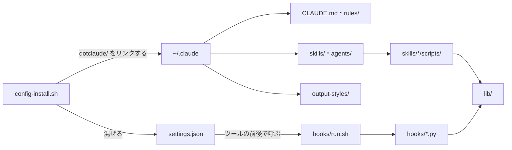

# claude-config

Claude Code の全リポジトリに共通の決まりを、`~/.claude` からシンボリックリンクで指して使う。


## ✨ 機能

| 部品 | できること | 一覧 |
| --- | --- | --- |
| 決まり | 文書・Swift・報告の書き方を、当たるファイルを触る時に読み込ませる | [components.md](docs/config/components.md#-決まり) |
| フック | 決まりを読まずに進めた時や、確認の前に出そうとした時に止める、または書き方の外れを知らせる | [components.md](docs/config/components.md#-フック) |
| スキル | 企画・PR・App Store・手入れを、決まった手順で進める | [skills.md](docs/config/skills.md) |
| エージェント | 探す・作る・確かめる仕事を、重さに合うモデルに任せる | [components.md](docs/config/components.md#-エージェント) |
| ひな形 | ビルドとテストが通る iOS アプリのリポジトリを作る | [ios-app](dotclaude/skills/app-init/templates/ios-app/) |

## 🗺️ 全体像



### フォルダ

```text
claude-config/
├── bin/
├── docs/
│   ├── app/
│   ├── config/
│   └── images/
├── dotclaude/
│   ├── CLAUDE.md
│   ├── README.md
│   ├── agents/
│   ├── hooks/
│   ├── output-styles/
│   ├── rules/
│   ├── settings.json
│   └── skills/
├── lib/
└── tests/
    ├── bin/
    ├── hooks/
    ├── skills/
    └── support/
```

| フォルダ | 役割 | 読み手 |
| --- | --- | --- |
| [bin/](bin/) | 入れる、検査する、文書を読むスクリプトの入口 | 人・仕組み |
| [docs/app/](docs/app/) | アプリの共通の構成。アプリのリポジトリから名前で指される | 人・Claude |
| [docs/config/](docs/config/) | claude-config を直す時の決まり | 人・Claude |
| [docs/images/](docs/images/) | 文書の画像 | 人 |
| [dotclaude/](dotclaude/) | `~/.claude` に配るもの。中の形は `~/.claude` と同じにする | |
| [dotclaude/CLAUDE.md](dotclaude/CLAUDE.md)・[dotclaude/rules/](dotclaude/rules/) | いつも、または当たるファイルを触る時に読み込まれる決まり | Claude（一部は人） |
| [dotclaude/agents/](dotclaude/agents/) | 任せる相手 | Claude |
| [dotclaude/hooks/](dotclaude/hooks/) | 決まりを守らせるフック | 仕組み |
| [dotclaude/output-styles/](dotclaude/output-styles/) | 報告の形 | Claude |
| [dotclaude/settings.json](dotclaude/settings.json) | フックと許可の登録 | 仕組み |
| [dotclaude/skills/](dotclaude/skills/) | 手順と、手順が走らせるスクリプト | Claude |
| [lib/](lib/) | フック・スクリプト・スキルの入口から読まれる中身 | 仕組み |
| [tests/](tests/) | フックとスクリプトのテスト | 人・仕組み |
| [CLAUDE.md](CLAUDE.md) | このリポジトリだけの決まり | Claude |

## 💻 実行環境

| 道具 | 版 |
| --- | --- |
| Claude Code | 最新 |
| Python | 3.9 以上 |
| jq | 最新 |

## 🚀 入れ方

```sh
git clone https://github.com/yossibank/claude-config ~/Applications/AI/claude-config
~/Applications/AI/claude-config/bin/config-install.sh
```

## 📚 文書

| 文書 | 読む時 | 中身 |
| --- | --- | --- |
| [bin/README.md](bin/README.md) | 入口のスクリプトを探す時 | 名前の頭のまとまりと、一覧のある文書 |
| [docs/README.md](docs/README.md) | 文書を探す時 | フォルダの役割と、claude-config の文書を読む順 |
| [docs/app/ios-naming.md](docs/app/ios-naming.md) | ファイルを足す・名前を付ける時 | iOS アプリのフォルダとファイルの名前、迷いやすい置き場所 |
| [docs/app/ios-architecture.md](docs/app/ios-architecture.md) | 構成を決める時 | iOS アプリのフォルダ、依存の向き、テスト |
| [docs/config/components.md](docs/config/components.md) | 部品を知る時 | 決まり・フック・エージェント・スクリプト・環境変数 |
| [docs/config/development.md](docs/config/development.md) | claude-config を直す時 | 名前の付け方・スクリプトの書き方・共通の処理・足し方 |
| [docs/config/improvements.md](docs/config/improvements.md) | claude-config を調べ直す時 | まだ直していない改善と、直さないと決めたこと |
| [docs/config/layout.md](docs/config/layout.md) | ファイルを置く・分ける時 | フォルダの分け方、置ける場所、数が増えた時に分ける合図 |
| [docs/config/setup.md](docs/config/setup.md) | 入れる時 | config-install.sh がすること、settings.json の混ぜ方 |
| [docs/config/skills.md](docs/config/skills.md) | スキルを選ぶ時 | スキルを使う順と一覧 |
| [docs/config/testing.md](docs/config/testing.md) | claude-config を確かめる時 | make のコマンド・テストの置き方 |
| [dotclaude/README.md](dotclaude/README.md) | 配るものを探す時 | 配るものの種類と、一覧のある文書 |
| [lib/README.md](lib/README.md) | 共通の処理を探す時 | lib の名前の頭と持ち主の子フォルダ、ファイルの一覧 |
| [tests/README.md](tests/README.md) | テストを探す時 | テストと、テストの共通の処理の一覧 |
| [dotclaude/rules/docs-core.md](dotclaude/rules/docs-core.md)・[dotclaude/rules/docs-human.md](dotclaude/rules/docs-human.md)・[dotclaude/rules/docs-app.md](dotclaude/rules/docs-app.md) | 文書を書く時 | 文書の運用・文・表現、人が読む文書の形、アプリの文書の役割 |
