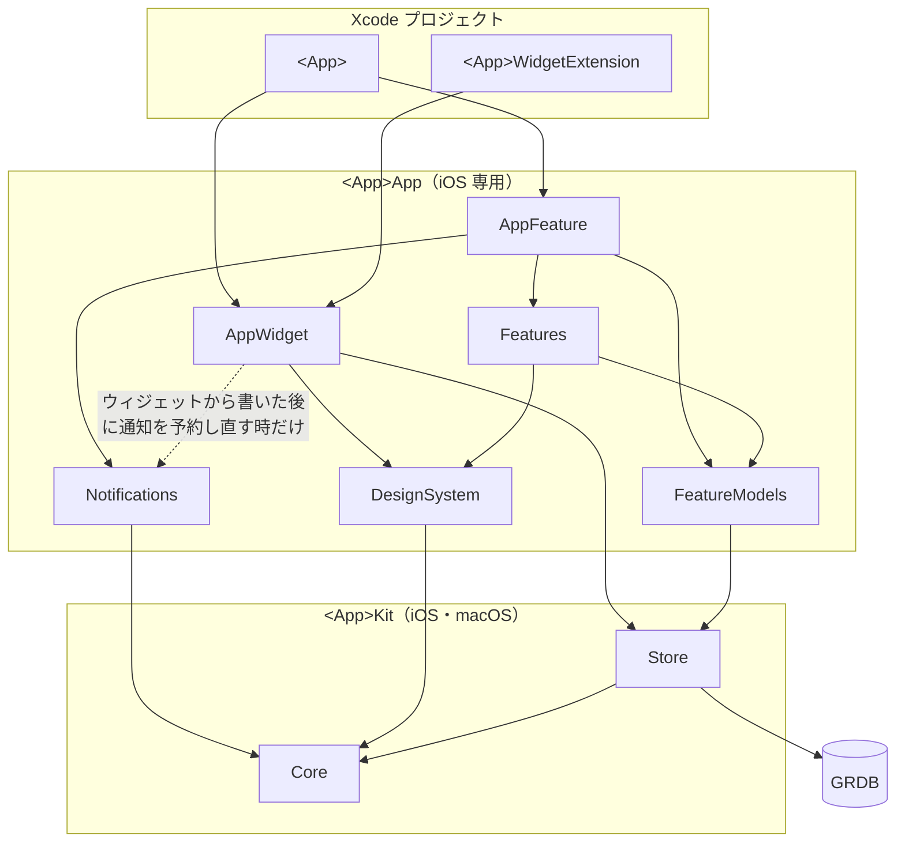

# iOS アプリの構成

> [!NOTE]
> 個人アプリの iOS 版で、どのアプリでも同じにするフォルダ・パッケージ・依存の向き・テストが分かる。
> 画面の組み立ては [ios-screens](ios-screens.md)、名前の決まりは [ios-naming](ios-naming.md) にある。
> アプリだけの事実と、ここから外れた点は、アプリの `docs/architecture.md` に書く。

文書の中の印は、アプリごとに次の値に置き換えて読む。

| 印 | 値 | 例 |
| --- | --- | --- |
| `<App>` | アプリの名前 | `Kakeibot` |
| `<app>` | `<App>` の小文字 | `kakeibot` |

## 🗺️ 全体像

**依存は、上から下へだけ向ける。** 例外は AppWidget から Notifications への 1 本だけである。ウィジェットから書いた後に、通知を予約し直す時に使う。



## 🛠️ 使う技術

既定の技術は、次のとおりである。変えたら、アプリの `docs/decisions/` に理由を書く。

| 項目 | iOS |
| --- | --- |
| 言語 | Swift 6 |
| 画面 | SwiftUI ＋ `@Observable` |
| 保存 | GRDB（SQLite） |
| ウィジェット | WidgetKit |
| 通信 | なし。通知を持つ時も、端末の中で予約する |

## 📂 リポジトリと ios フォルダ

リポジトリの直下と `ios/` の中は、どのアプリも同じ形にする。

### リポジトリの直下

`android/` は、要る時に足す。`spec/` は、両 OS で同じ結果が要る時に足す。

```text
<app>/
├── docs/
├── ios/
├── scripts/
│   ├── find-simulator.sh
│   └── verify.sh
├── spec/
├── .claude/
│   ├── rules/
│   └── skills/
├── .pre-commit-config.yaml
├── .swiftformat
├── Brewfile
├── Makefile
└── Mintfile
```

| フォルダ・ファイル | 中身 |
| --- | --- |
| `scripts/find-simulator.sh` | 使える先頭の iPhone のシミュレーターの UDID を出す |
| `scripts/verify.sh` | 確認の名前とコマンドを受け、成否と失敗の行だけを出す |
| `docs/` | アプリの文書。作る文書と足す条件は、claude-config の `dotclaude/rules/docs-app.md` にある |
| `spec/` | 両 OS で同じ結果が要る計算の fixtures と、書き出しの形 |
| `.claude/rules/` | このアプリだけの決まり |
| `.claude/skills/` | このアプリだけの手順 |
| `.pre-commit-config.yaml` | commit の前の確認（SwiftFormat） |
| `Brewfile` | jq、Mint、pre-commit、xcbeautify |
| `Makefile` | [動かし方](#-動かし方)の make のコマンド |
| `Mintfile` | SwiftFormat と LicensePlist の版 |

### Xcode のプロジェクトとパッケージ（ios/）

Xcode では `<App>.xcworkspace` を開く。

```text
ios/
├── <App>/
├── <App>.xcodeproj
├── <App>.xctestplan
├── <App>.xcworkspace
├── <App>Widget/
├── license_plist.yml
└── Packages/
    ├── <App>App/
    └── <App>Kit/
```

| フォルダ・ファイル | 中身 |
| --- | --- |
| `<App>/` | アプリ（`@main` で AppFeature を呼ぶだけ）、アプリアイコン、起動画面、設定アプリに出すライセンス |
| `<App>.xcodeproj` | アプリとウィジェットのターゲット |
| `<App>.xctestplan` | テストターゲットをまとめたテストプラン |
| `<App>.xcworkspace` | プロジェクトと 2 つのパッケージを並べる |
| `<App>Widget/` | ウィジェット（`@main` で AppWidget を呼ぶだけ） |
| `license_plist.yml` | LicensePlist に手で足すライセンス |
| `Packages/<App>App/` | 画面と、OS の仕組みへの反映。Kit との違いは[パッケージ](#-パッケージ)にある |
| `Packages/<App>Kit/` | 画面を持たない型と計算、保存 |

ターゲットと ID は、次の形にそろえる。

| 項目 | アプリ | ウィジェット |
| --- | --- | --- |
| ターゲット | `<App>` | `<App>WidgetExtension` |
| Bundle ID | `com.yossibank.<app>` | `com.yossibank.<app>.widget` |
| App Group | `group.com.yossibank.<app>` | 同じ |
| Data Protection | | `NSFileProtectionComplete` |
| ライセンスの一覧 | `<App>/Settings.bundle`。`make licenses` で LicensePlist が作る | 入れない |

## 🚀 動かし方

ビルドとテストは、xcbeautify があれば出力を通して整える。

| コマンド | すること |
| --- | --- |
| `make setup` | Brewfile・Mintfile の道具を入れ、pre-commit のフックを置く |
| `make open` | Xcode でワークスペースを開く。`BRANCH=<ブランチ>` で、そのワークツリーのものを開く |
| `make format` | SwiftFormat で整える |
| `make licenses` | 設定アプリに出すライセンスの一覧を、LicensePlist で作り直す |
| `make build` | iOS シミュレーター向けにビルドする |
| `make verify` | 書き方と設計の検査、画面の `import Store` の検査を走らせる。続けて、Kit の `swift test` と iOS のビルドを通す |
| `make test` | テストプランを iOS シミュレーターで走らせる。出力は `.build/test.log` にも残す |
| `make test-build` | 走らせずにコンパイルだけする |
| `make snapshot SNAPSHOT=<セット>` | `.claude/snapshots/<セット>` を ui-snapshot で描く。出力は `.build/snapshots/` |

## 📦 パッケージ

パッケージは 2 つに分ける。中のフォルダは、そのコードを作る時に足す。

| パッケージ | 入れるもの | 動く OS | テストの方法 |
| --- | --- | --- | --- |
| Kit | 画面を持たない型と計算、保存 | iOS・macOS | Mac の上で `swift test` |
| App | 画面と、OS の仕組みへの反映 | iOS 専用 | Xcode |

### Kit

```text
<App>Kit/
├── Sources/
│   ├── Core/
│   │   ├── Concepts/
│   │   └── Shared/
│   └── Store/
│       ├── Database/
│       ├── Migrations/
│       ├── Queries/
│       ├── Records/
│       └── Writes/
└── Tests/
    ├── CoreTests/
    └── StoreTests/
```

| フォルダ | 中身 |
| --- | --- |
| `Core/Concepts/` | 概念ごとのフォルダに、型と計算を一緒に入れる |
| `Core/Shared/` | 概念をまたいで使う型。型付きの ID など |
| `Store/Database/` | App Group、`DatabasePool`、裏に回る時に止める処理 |
| `Store/Migrations/` | 版ごとに 1 ファイル |
| `Store/Queries/` | 読み出し |
| `Store/Records/` | Core の型を GRDB で読み書きできるようにする |
| `Store/Writes/` | 書き込み |
| `CoreTests/` | Core と同じフォルダ分け |
| `StoreTests/` | メモリ上の DB |

### App

`AppWidget` はウィジェットを、`Notifications` は通知を持つ時に足す。

```text
<App>App/
├── Sources/
│   ├── AppFeature/
│   ├── AppWidget/
│   ├── DesignSystem/
│   │   ├── Components/
│   │   └── Theme/
│   ├── FeatureModels/
│   │   ├── Screens/
│   │   └── Shared/
│   ├── Features/
│   │   ├── Screens/
│   │   └── Shared/
│   └── Notifications/
└── Tests/
    ├── AppFeatureTests/
    ├── DesignSystemTests/
    └── FeaturesTests/
```

| フォルダ | 中身 |
| --- | --- |
| `AppFeature/` | `AppModel`、`RootView`、`MainView`（タブとシート）、起動の処理 |
| `AppWidget/` | `Widgets/` にウィジェットごと、`Intents/` に `AppIntent` を置く。`Shared/` はタイムラインなど |
| `DesignSystem/Components/` | 部品の種類ごとのフォルダ |
| `DesignSystem/Theme/` | 色・角の丸み・字体・文字の大きさ |
| `FeatureModels/Screens/` | 画面のモデル。フォルダは `Features/Screens/` と同じ形にする |
| `FeatureModels/Shared/` | 複数の画面で使うモデルと値の型。土台の型は `Model/` に置く |
| `Features/Screens/` | 画面ごとのフォルダ。タブの画面は `Tabs/` の下 |
| `Features/Shared/` | 複数の画面で使う部品。役割ごとのフォルダ |
| `FeaturesTests/` | 画面のモデルのテスト。`FeatureModels` と `Store` を読む |
| `Notifications/` | あるべき通知の予約と、今の予約の差を OS に反映する。押された通知の行き先を受ける |

## 📱 Features と AppFeature

画面の処理は、各画面・画面のモデル・画面どうしをつなぐ部分に分ける。

| ターゲット | 受け持つこと | 知らないこと |
| --- | --- | --- |
| FeatureModels | 画面のモデル。DB の読み書きと、画面に出す値の計算 | 画面の見た目、タブ、通知、ウィジェット |
| Features | 1 つ 1 つの画面の表示と操作 | DB、ほかの画面、タブ、通知、ウィジェット |
| AppFeature | タブ、シート、移動、起動時の処理、通知とウィジェットへの反映 | DB、各画面の中身 |

**`Features` と `AppFeature` は、`Store` に依存しない。** DB は `ScreenParts` に包んで受け取り、`FeatureModels` のモデルだけが開く。

モデルの作り方・土台の型・起動と外からの入口は、[ios-screens](ios-screens.md) にある。

## 🪟 ウィジェット

ウィジェットは、AppWidget が App Group の DB を読むだけで表示する。

| 場面 | 動き |
| --- | --- |
| 計算 | アプリの画面と同じ Core のものを使う |
| 表の形が古い | 読まない |
| 更新 | AppModel が見張りで起こす。日付が変わる時はタイムラインで切り替える |
| ウィジェットから書く | その機能を持つ時だけ、AppIntent が書き込み用に DB を開く |

## 🧪 テスト

テストターゲットは `ios/<App>.xctestplan` にまとめ、`<App>` スキームに付ける。走らせるコマンドは [動かし方](#-動かし方) にある。

テストの対象と方法は、次のとおりである。

| 対象 | 方法 |
| --- | --- |
| Core | Mac の上で `swift test`。fixtures は `#filePath` からの相対パスで読む |
| Store | メモリ上の DB で、表の形の変更・集計・書き出しの往復 |
| FeatureModels | 処理のある画面のモデル。テストは `FeaturesTests` に置く |
| AppFeature | AppModel と通知の予約。通知の予約係だけテスト用に差し替える |
| 見た目 | プレビューと ui-snapshot で描いた PNG を目で確かめる。XCUITest の UI テストは書かない |

PR ごとに手元で回す。CI の扱いは、[testing](../config/testing.md#-動かし方) にある。

> [!IMPORTANT]
> パッケージは、プロジェクトのフォルダとしても登録する。こうしないと、スキームからパッケージのテストターゲットが見えない。
