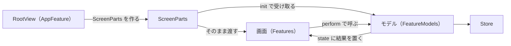
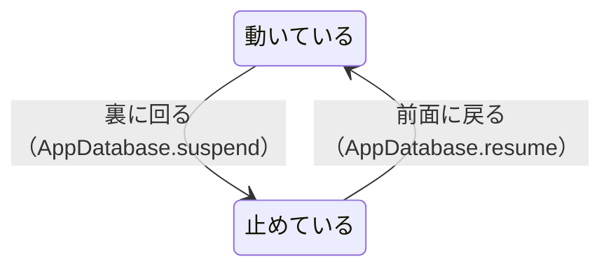
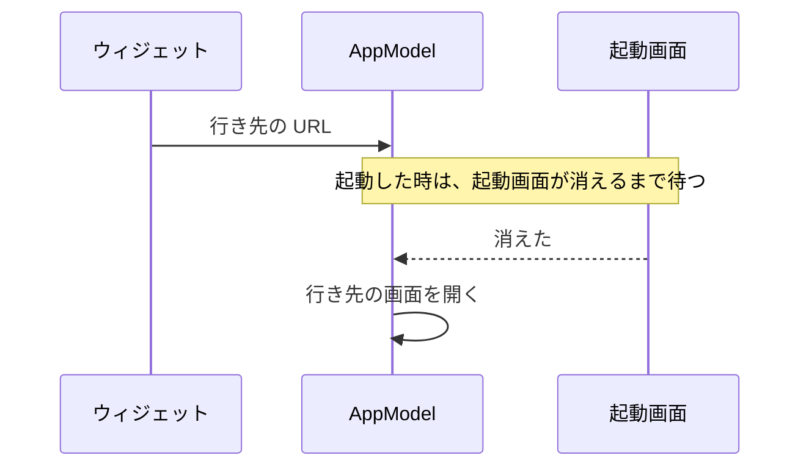

# iOS アプリの画面の組み立て

> [!NOTE]
> 個人アプリの iOS 版で、画面とモデルの分け方、起動と外からの入口の作り方が分かる。
> ターゲットと依存の向きは [ios-architecture](ios-architecture.md)、名前の決まりは [ios-naming](ios-naming.md) にある。
> アプリだけの組み立ては、アプリの `docs/architecture-screens.md` に書く。

## 📱 画面とモデル

画面は `Features` に、画面のモデルは `FeatureModels` に置く。**DB を開けるのは、モデルだけである。**

### 画面のモデル

画面のモデルは、場面ごとに次の決まりで作る。計算は Core に任せ、書き込みは DB に書くだけにする。

| 場面 | 決まり |
| --- | --- |
| モデルを置く | 処理のある画面だけ `@Observable` のモデルを置く。表示だけの画面には置かない |
| 置き場所 | `FeatureModels` の、画面と同じ名前のフォルダに置く。テストは `FeaturesTests` に置く |
| 受け取るもの | DB と時計を包んだ `ScreenParts` を、init の引数で受け取る |
| ほかの画面を開く | 開く関数は、Core の型だけを使う（`open<画面>(<型>.ID)`） |
| 子の画面 | 開いている画面は、親のモデルの `state` の 1 つの値で持つ。子のモデルは、親のモデルの関数が作る |
| 設定の一覧 | 項目の enum を持つ。移る先は AppFeature が決める |
| DB を見張る | `ValueObservation` で見張る。保存すると、見張っている画面が自動で変わる |
| 見張りの書き方 | 画面のモデルが共通で持つ `observe(_:failure:receive:)` で書く。読めなかった時は、エラーのバナーに出す |
| 最初の読み込み | 見張りと一緒に `run()` にまとめる。1 回だけ読む値を先に読み、見張りは並べて動かす |
| 状態とモデルの形 | `dotclaude/rules/code-design.md` に従う。数の上限は、code-design-check が確かめる |
| 同じ種類の画面 | 一覧や編集の画面が 2 つ目になる時に、共通のプロトコルと部品に括ってから足す |

新しい画面は、`code-screen` のスキルのひな形から足す。モデル・画面・テストが、この形で置かれる。

DB を同期で呼ぶアプリは、ひな形の同期の版を使う。見張りを持たず、モデルの `refresh()` で読み直す。共通の形との違いは、アプリの `docs/architecture.md` に書く。

> [!TIP]
> `observe` はひな形に無い。最初に見張る画面を作る時に足す。置き場所は `FeatureModels/Shared/Model/ScreenModel.swift` である。

### 画面とモデルをつなぐ土台

土台の型は、app-init が最初から置く。中身は、`code-screen` のスキルのひな形と同じである。

| 型・関数 | 役割 | 置き場所 |
| --- | --- | --- |
| `ScreenParts` | DB と時計を包んで、画面からモデルへ渡す。中の DB は `FeatureModels` だけが読む | `FeatureModels/Shared/Model/` |
| `ScreenClock` | モデルの時計。今の時刻は、ここから受け取る | `FeatureModels/Shared/Model/` |
| `ScreenPerforming` | 画面がモデルの async の関数を呼ぶ口。`perform` が `Task` を始める | `FeatureModels/Shared/Model/` |
| `ScreenOutcome` | 保存できた・消した、の結果。モデルが `state` に置く | `FeatureModels/Shared/Model/` |
| `onOutcome` | 画面が `ScreenOutcome` の変化を 1 か所で受ける modifier | `Features/Shared/Model/` |
| `ScreenEditable` | 画面が書いてよい値の型の印。`State` の画面から書ける値は、この印の型だけにする | `FeatureModels/Shared/Model/` |
| `Shown` | 表示中のシート・確認・メニューを、1 つの値で持つ | `FeatureModels/Shared/Model/` |
| `ModelTask` | 保存などの実行中の印。二度押しは、呼ぶ側が `isRunning` で止める | `FeatureModels/Shared/Model/` |
| `Loadable` | 読み込み中・読めた・失敗を、1 つの値で持つ | `FeatureModels/Shared/Model/` |

ほかの画面の部品と使い方は、`dotclaude/rules/code-design.md` の「画面の部品」にある。

画面は、`Store` を import しない。守らせる仕組みは、次のとおりである。

| 仕組み | 止めること |
| --- | --- |
| `Package.swift` の依存 | `Features` と `AppFeature` の依存に、`Store` を書かない |
| `Features` の `MemberImportVisibility` | import していないモジュールの関数を、画面から呼べない |
| `make verify` の `screens-no-store` | `Features` と `AppFeature` の下の `import Store` を、grep で止める |

> [!IMPORTANT]
> Xcode は、依存に書いていないモジュールの import を通してしまう。grep の 1 行は、そのために置く。

### 共通の部品の一覧

複数の画面で使う仕組みは、アプリの `docs/architecture-parts.md` に一覧で持つ。app-init が、土台の行を入れた最初の版を置く。

| 列 | 書くこと |
| --- | --- |
| 仕組み | 型かプロトコルの名前 |
| 使いどころ | どんな画面や処理を作る時に使うか |
| 置き場所 | ファイルのあるフォルダ |

一覧は、CLAUDE.md の文書の表で「機能・画面を足す」の先に読む文書に入れる。`Shared` のプロトコルが一覧に無いと、code-design-check が止める。

## 🚀 起動と入口

起動は AppFeature が受け持ち、画面どうしをつなぐ。

### AppModel と MainView

AppModel は起動と行き先を、MainView はタブとシートを持つ。MainView は、タブを持つ時に足す。

| 型 | 持つもの |
| --- | --- |
| AppModel | 起動の状態（DB を開いている途中、最初の設定、準備済み、失敗）、今日、押された通知の行き先 |
| AppModel の DB | `ScreenParts` を返す関数を、init で受け取る。`RootView` は `ScreenParts.appGroup(clock:)` を渡す |
| MainView | タブのモデル（アプリが動いている間ずっと持ち、今日が変わったら渡し直す）、開いているシート |

### 起動と画面復帰

起動・前面に戻る・日付が変わる時に行う処理を、上から順に並べる。

| 処理 | 起動 | 前面に戻る | 日付が変わる |
| --- | --- | --- | --- |
| DB を開き、表の形を最新にする | する | | |
| 今日を決める | する | する | する |
| ほかのプロセス（ウィジェット）の書き込みを、見張りに知らせて読み直させる | | する | する |
| 通知を予約し直す（通知を持つ時） | する | する | する |

> [!IMPORTANT]
> DB は、裏に回ると止め、前面に戻ると再開する。書き込みの最中に裏に回っても、`0xdead10cc` で終了させないためである。

止める・再開するは、ひな形に無い。書き込みを持つ時に、`FeatureModels` の関数にして AppModel から呼ぶ。

### 外からの入口

ウィジェット・通知などから開く先は、1 つの行き先の型で表す。ウィジェットからは、行き先の文字列を `<app>://` の URL にして渡す。

