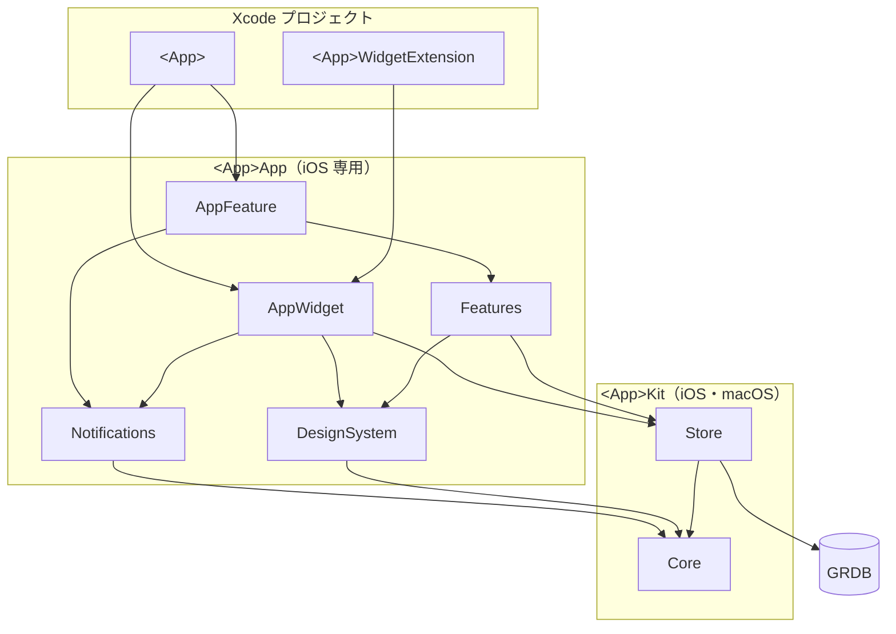
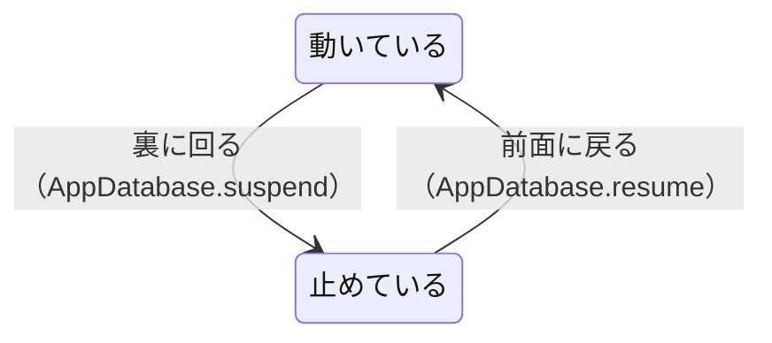
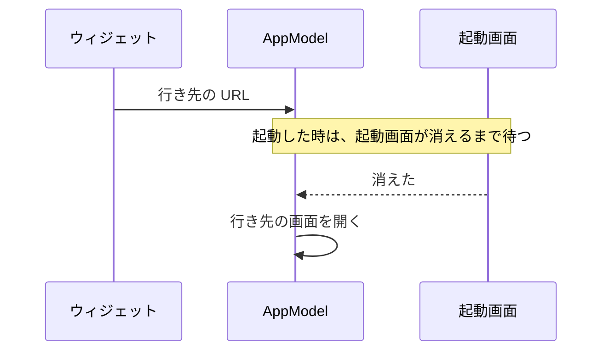

# iOS アプリの構成

個人アプリの iOS 版で、どのアプリでも同じにする構成を書く。

> [!NOTE]
> フォルダ・パッケージの分け方と、依存の向きが分かる。
> 画面・ウィジェット・テストの作り方と、名前の決まりも分かる。
> アプリだけの事実と、ここから外れた点は、アプリの `docs/architecture.md` に書く。

文書の中の印は、アプリごとに次の値に置き換えて読む。

| 印 | 値 | 例 |
| --- | --- | --- |
| `<App>` | アプリの名前 | `Kakeibot` |
| `<app>` | `<App>` の小文字 | `kakeibot` |

## 🗺️ 全体像

依存は、上から下へだけ向ける。`AppWidget --> Notifications` は、ウィジェットから書いた後に通知を予約し直す時だけ置く。



## 🔧 使う技術

既定の技術は、次のとおりである。変えたら、アプリの `docs/decisions/` に理由を書く。

| 項目 | iOS |
| --- | --- |
| 言語 | Swift 6 |
| 画面 | SwiftUI ＋ `@Observable` |
| 保存 | GRDB（SQLite） |
| ウィジェット | WidgetKit |
| 通信 | なし。通知を持つ時も、端末の中で予約する |

## 📂 リポジトリと ios フォルダ

リポジトリの直下と `ios/` の中は、どのアプリも同じ形にする。

### リポジトリの直下

`android/` と `spec/` は、要る時に足す。

```text
<app>/
├── docs/
├── ios/
├── scripts/
│   ├── simulator.sh
│   └── verify.sh
├── spec/
├── .claude/
│   ├── rules/
│   └── skills/
├── .pre-commit-config.yaml
├── .swiftformat
├── Brewfile
├── Makefile
└── Mintfile
```

| フォルダ・ファイル | 中身 |
| --- | --- |
| `scripts/simulator.sh` | 使える先頭の iPhone のシミュレーターの UDID を出す |
| `scripts/verify.sh` | 確認の名前とコマンドを受け、成否と失敗の行だけを出す |
| `spec/` | 両 OS で同じ結果が要る計算の fixtures と、書き出しの形 |
| `.claude/rules/` | このアプリだけの決まり |
| `.claude/skills/` | このアプリだけの手順 |
| `.pre-commit-config.yaml` | commit の前の確認（SwiftFormat） |
| `Brewfile` | Mint、pre-commit、xcbeautify |
| `Makefile` | 下の make のコマンド |
| `Mintfile` | SwiftFormat と LicensePlist の版 |

### make のコマンド

ビルドとテストは、xcbeautify があれば出力を通して整える。

| コマンド | すること |
| --- | --- |
| `make setup` | Brewfile・Mintfile の道具を入れ、pre-commit のフックを置く |
| `make open` | Xcode でワークスペースを開く。`BRANCH=<ブランチ>` で、そのワークツリーのものを開く |
| `make format` | SwiftFormat で整える |
| `make licenses` | 設定アプリに出すライセンスの一覧を、LicensePlist で作り直す |
| `make build` | iOS シミュレーター向けにビルドする |
| `make verify` | Kit の `swift test` と iOS のビルドを `scripts/verify.sh` を通して走らせる |
| `make test` | テストプランを iOS シミュレーターで走らせる |
| `make test-build` | 走らせずにコンパイルだけする |
| `make snapshot SNAPSHOT=<セット>` | `.claude/snapshots/<セット>` を ui-snapshot で描く。出力は `.build/snapshots/` |

### Xcode のプロジェクトとパッケージ（ios/）

Xcode では `<App>.xcworkspace` を開く。

```text
ios/
├── <App>/
├── <App>.xcodeproj
├── <App>.xctestplan
├── <App>.xcworkspace
├── <App>Widget/
├── license_plist.yml
└── Packages/
    ├── <App>App/
    └── <App>Kit/
```

| フォルダ・ファイル | 中身 |
| --- | --- |
| `<App>/` | アプリ（`@main` で AppFeature を呼ぶだけ）、アプリアイコン、起動画面、設定アプリに出すライセンス |
| `<App>.xcodeproj` | アプリとウィジェットのターゲット |
| `<App>.xctestplan` | テストターゲットをまとめたテストプラン |
| `<App>.xcworkspace` | プロジェクトと 2 つのパッケージを並べる |
| `<App>Widget/` | ウィジェット（`@main` で AppWidget を呼ぶだけ） |
| `license_plist.yml` | LicensePlist に手で足すライセンス |
| `Packages/<App>App/` | iOS 専用。Xcode でテスト |
| `Packages/<App>Kit/` | iOS と macOS。Mac の上で `swift test` |

ターゲットと ID は、次の形にそろえる。

| 項目 | アプリ | ウィジェット |
| --- | --- | --- |
| ターゲット | `<App>` | `<App>WidgetExtension` |
| Bundle ID | `com.yossibank.<app>` | `com.yossibank.<app>.widget` |
| App Group | `group.com.yossibank.<app>` | 同じ |
| Data Protection | | `NSFileProtectionComplete` |
| ライセンスの一覧 | `<App>/Settings.bundle`。`make licenses` で LicensePlist が作る | 入れない |

## 📦 パッケージ

パッケージは 2 つに分ける。中のフォルダは、そのコードを作る時に足す。

### Kit

画面を持たない型と計算、保存を入れる。macOS でも動くので、Mac の上で `swift test` を回せる。

```text
<App>Kit/
├── Sources/
│   ├── Core/
│   └── Store/
│       ├── Database/
│       ├── Migrations/
│       ├── Queries/
│       ├── Records/
│       └── Writes/
└── Tests/
    ├── CoreTests/
    └── StoreTests/
```

| フォルダ | 中身 |
| --- | --- |
| `Core/` | 概念ごとのフォルダに、型と計算を一緒に入れる |
| `Store/Database/` | App Group、DatabasePool、裏に回る前の対策 |
| `Store/Migrations/` | 版ごとに 1 ファイル |
| `Store/Queries/` | 読み出し |
| `Store/Records/` | Core の型を GRDB で読み書きできるようにする |
| `Store/Writes/` | 書き込み |
| `CoreTests/` | Core と同じフォルダ分け |
| `StoreTests/` | メモリ上の DB |

### App

画面と、OS の仕組みへの反映を入れる。`AppWidget` はウィジェットを、`Notifications` は通知を持つ時に足す。

```text
<App>App/
├── Sources/
│   ├── AppFeature/
│   ├── AppWidget/
│   ├── DesignSystem/
│   │   ├── Components/
│   │   └── Theme/
│   ├── Features/
│   │   ├── Screens/
│   │   └── Shared/
│   └── Notifications/
└── Tests/
    ├── AppFeatureTests/
    ├── DesignSystemTests/
    └── FeaturesTests/
```

| フォルダ | 中身 |
| --- | --- |
| `AppFeature/` | AppModel、RootView、MainView（タブとシート）、起動の処理 |
| `AppWidget/` | ウィジェットの見た目、タイムライン、AppIntent |
| `DesignSystem/Components/` | 部品の種類ごとのフォルダ |
| `DesignSystem/Theme/` | 色・角の丸み・字体・文字の大きさ |
| `Features/Screens/` | 画面ごとのフォルダ。タブの画面は `Tabs/` の下 |
| `Features/Shared/` | 複数の画面で使う部品とモデル。役割ごとのフォルダ |
| `Notifications/` | 予約されているべき通知と今の予約の差を OS に反映する。押された通知の行き先を受ける |

## 📱 Features と AppFeature

画面の処理は、各画面と、画面どうしをつなぐ部分に分ける。

| ターゲット | 受け持つこと | 知らないこと |
| --- | --- | --- |
| Features | 1 つ 1 つの画面の表示と操作 | ほかの画面、タブ、通知、ウィジェット |
| AppFeature | タブ、シート、移動、起動時の処理、通知とウィジェットへの反映 | 各画面の中身 |

### 画面のモデル

画面のモデルは、場面ごとに次の決まりで作る。

| 場面 | 決まり |
| --- | --- |
| 作る時 | 処理のある画面だけ `@Observable` のモデルを置く。表示だけの画面には置かない |
| | DB・今日の日付・ほかの画面を開く関数を、引数で受け取る |
| | ほかの画面を開く関数は、Core の型だけを使う（`open<画面>(<型>.ID)`） |
| | 設定の一覧は項目の enum を持つ。移る先は AppFeature が決める |
| 見張り | DB は `ValueObservation` で見張る。保存すると、見張っている画面が自動で変わる |
| | 画面のモデルが共通で持つ `observe(_:failure:receive:)` で書く。読めなかった時は、エラーのバナーに出す |
| | 最初の読み込みと一緒に `run()` にまとめる。1 回だけ読む値を先に読み、見張りは並べて動かす |
| 計算と書き込み | 計算は Core に任せる。書き込みは DB に書くだけ |

> [!TIP]
> `observe` はひな形に無い。最初に見張る画面を作る時に、kakeibot から写す。
> 写し元は `Features/Shared/Model/ScreenModel.swift` である。

### AppModel と MainView

AppModel は起動と行き先を、MainView はタブとシートを持つ。

| 型 | 持つもの |
| --- | --- |
| AppModel | 起動の状態（DB を開いている途中、最初の設定、準備済み、失敗）、今日、押された通知の行き先 |
| MainView | タブのモデル（アプリが動いている間ずっと持ち、今日が変わったら渡し直す）、開いているシート |

### 起動と画面復帰

起動・前面に戻る・日付が変わる時に行う処理を、上から順に並べる。

| 処理 | 起動 | 前面に戻る | 日付が変わる |
| --- | --- | --- | --- |
| DB を開き、表の形を最新にする | する | | |
| 今日を決める | する | する | する |
| ほかのプロセス（ウィジェット）の書き込みを、見張りに知らせて読み直させる | | する | する |
| 通知を予約し直す（通知を持つ時） | する | する | する |

DB は、裏に回ると止め、前面に戻ると再開する。



> [!IMPORTANT]
> 書き込みの最中に裏に回っても、`0xdead10cc` で終了させないための仕組みである。

### 外からの入口

ウィジェット・通知などから開く先は、1 つの行き先の型で表す。ウィジェットからは、行き先の文字列を `<app>://` の URL にして渡す。



## 🧩 ウィジェット

ウィジェットは、AppWidget が App Group の DB を読むだけで開く。

| 場面 | 動き |
| --- | --- |
| 計算 | アプリの画面と同じ Core のものを使う |
| 表の形が古い | 読まない |
| 更新 | AppModel が見張りで起こす。日付が変わる時はタイムラインで切り替える |
| ウィジェットから書く | その機能を持つ時だけ、AppIntent が書き込み用に開く |

## 🧪 テスト

テストターゲットは `ios/<App>.xctestplan` にまとめ、`<App>` スキームに付ける。走らせるコマンドは [make のコマンド](#make-のコマンド) にある。

> [!IMPORTANT]
> パッケージは、プロジェクトのフォルダとしても登録する。こうしないと、スキームからパッケージのテストターゲットが見えない。

**CI は置かず、PR ごとに手元で回す。**

テストの対象と方法は、次のとおりである。

| 対象 | 方法 |
| --- | --- |
| Core | Mac の上で `swift test`。fixtures は `#filePath` からの相対パスで読む |
| Store | メモリ上の DB で、表の形の変更・集計・書き出しの往復 |
| Features | 処理のある画面のモデル |
| AppFeature | AppModel と通知の予約。通知の予約係だけテスト用に差し替える |
| 見た目 | プレビューで目で確かめる。UI テストは書かない |

## 🏷️ 名前の決まり

フォルダとファイルの名前は、次の決まりで付ける。Swift のファイル全般の決まりは `rules/swift-core.md` にある。

| 対象 | 名前の決まり | 例 |
| --- | --- | --- |
| DesignSystem の部品のフォルダ | 名前の順に並べた時、中が 1 つの種類の部品だけになるように分ける | |
| `Screens` の下 | 画面の名前。一覧の画面は複数形 | |
| `Shared` の下 | 部品の役割の名前 | |
| フォルダ | ファイルが 1 つだけのフォルダは作らず、近いフォルダに入れる。ターゲットの直下は例外 | |
| ファイル | 中の型の名前。拡張は `<型>+<役割>` | `<型>+<役割>.swift` |
| モディファイア | DesignSystem の、画面をまたいで使うものだけ `View+<役割>` にする。画面ごとのものは画面の名前で始める | `View+<役割>.swift` |
| fixtures | 頭に、試す型の名前を kebab-case で付ける | `<型>-<場合>.json` |
