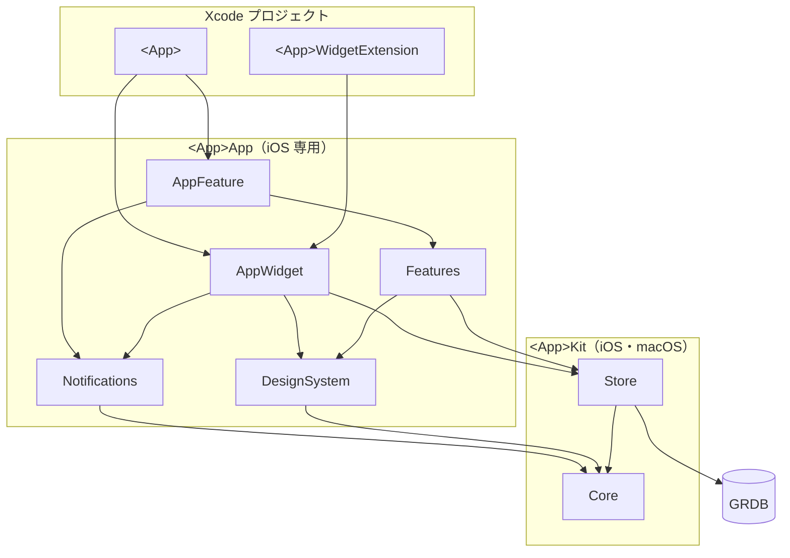

# iOS アプリの構成

個人アプリの iOS 版で、どのアプリでも同じにする構成を書く。`<App>` はアプリの名前（`Kakeibot` など）、`<app>` はその小文字である。アプリの `docs/architecture.md` には、ここから外れた点と、アプリだけの事実を書く。

## 使う技術

既定の技術は、次のとおりである。変えたら、アプリの `docs/decisions/` に理由を書く。

| 項目 | iOS |
| --- | --- |
| 言語 | Swift 6 |
| 画面 | SwiftUI ＋ `@Observable` |
| 保存 | GRDB（SQLite） |
| ウィジェット | WidgetKit |
| 通信 | なし。通知を持つ時も、端末の中で予約する |

## リポジトリ

リポジトリの直下は、次の形である。`android/` と `spec/` は、要る時に足す。

```
<app>/
├── docs/
├── ios/
├── scripts/
│   ├── simulator.sh         使える先頭の iPhone のシミュレーターの UDID を出す
│   └── verify.sh            確認の名前とコマンドを受け、成否と失敗の行だけを出す
├── spec/                    両 OS で同じ結果が要る計算の fixtures と、書き出しの形
├── .claude/
│   ├── rules/               このアプリだけの決まり
│   └── skills/              このアプリだけの手順
├── .pre-commit-config.yaml  commit の前の確認（SwiftFormat）
├── .swiftformat
├── Brewfile                 Mint、pre-commit、xcbeautify
├── Makefile                 準備・開く・整形・ライセンスの作り直し・確認・ビルド・テストのコマンド
└── Mintfile                 SwiftFormat と LicensePlist の版
```

## ios

`ios/` の中は、次の形である。

```
ios/
├── <App>/                   アプリ（@main で AppFeature を呼ぶだけ）、アプリアイコン、起動画面、設定アプリに出すライセンス
├── <App>.xcodeproj          アプリとウィジェットのターゲット
├── <App>.xctestplan         テストターゲットをまとめたテストプラン
├── <App>.xcworkspace        プロジェクトと 2 つのパッケージを並べる。Xcode ではこれを開く
├── <App>Widget/             ウィジェット（@main で AppWidget を呼ぶだけ）
├── license_plist.yml        LicensePlist に手で足すライセンス
└── Packages/
    ├── <App>App/            iOS 専用。Xcode でテスト
    └── <App>Kit/            iOS と macOS。Mac の上で swift test
```

ターゲットと ID は、次の形にそろえる。

| 項目 | アプリ | ウィジェット |
| --- | --- | --- |
| ターゲット | `<App>` | `<App>WidgetExtension` |
| Bundle ID | `com.yossibank.<app>` | `com.yossibank.<app>.widget` |
| App Group | `group.com.yossibank.<app>` | 同じ |
| Data Protection | | `NSFileProtectionComplete` |
| ライセンスの一覧 | `<App>/Settings.bundle`。`make licenses` で LicensePlist が作る | 入れない |

## パッケージ

パッケージは 2 つに分ける。中のフォルダは、そのコードを作る時に足す。

### Kit

画面を持たない型と計算、保存を入れる。macOS でも動くので、Mac の上で `swift test` を回せる。

```
<App>Kit/
├── Sources/
│   ├── Core/                概念ごとのフォルダに、型と計算を一緒に入れる
│   └── Store/
│       ├── Database/        App Group、DatabasePool、裏に回る前の対策
│       ├── Migrations/      版ごとに 1 ファイル
│       ├── Queries/         読み出し
│       ├── Records/         Core の型を GRDB で読み書きできるようにする
│       └── Writes/          書き込み
└── Tests/
    ├── CoreTests/           Core と同じフォルダ分け
    └── StoreTests/          メモリ上の DB
```

### App

画面と、OS の仕組みへの反映を入れる。`AppWidget` はウィジェットを、`Notifications` は通知を持つ時に足す。

```
<App>App/
├── Sources/
│   ├── AppFeature/          AppModel、RootView、MainView（タブとシート）、起動の処理
│   ├── AppWidget/           ウィジェットの見た目、タイムライン、AppIntent
│   ├── DesignSystem/
│   │   ├── Components/      部品の種類ごとのフォルダ
│   │   └── Theme/           色・角の丸み・字体・文字の大きさ
│   ├── Features/
│   │   ├── Screens/         画面ごとのフォルダ。タブの画面は Tabs/ の下
│   │   └── Shared/          複数の画面で使う部品とモデル。役割ごとのフォルダ
│   └── Notifications/       予約されているべき通知と今の予約の差を OS に反映、押された通知の行き先を受ける
└── Tests/
    ├── AppFeatureTests/
    ├── DesignSystemTests/
    └── FeaturesTests/
```

### 依存の向き

依存は、上から下へだけ向ける。`AppWidget --> Notifications` は、ウィジェットから書いた後に通知を予約し直す時だけ置く。



## 名前の決まり

フォルダとファイルの名前は、次の決まりで付ける。Swift のファイル全般の決まりは `rules/swift-core.md` にある。

- Core は概念ごとのフォルダに、型と計算を一緒に入れる
- Store は役割ごとのフォルダ（Queries・Writes・Records など）に分ける
- DesignSystem の部品は、Components の下の種類ごとのフォルダに入れる。名前の順に並べた時、フォルダの中が 1 つの種類の部品だけになるように分ける
- Features の `Screens` の下は画面の名前にする。一覧の画面は複数形
- Features の `Shared` の下は、部品の役割の名前にする
- ファイルが 1 つだけのフォルダは作らず、近いフォルダに入れる。ターゲットの直下は例外にする
- ファイル名は、中の型の名前にする。拡張は `<型>+<役割>` にする
- `View+役割` の名前は、DesignSystem の画面をまたいで使うモディファイアだけに付ける。画面ごとのモディファイアは、画面の名前で始める
- fixtures のファイル名の頭に、試す型の名前を kebab-case で付ける（`<型>-<場合>.json`）

## Features と AppFeature

画面の処理は、各画面と、画面どうしをつなぐ部分に分ける。

| ターゲット | 受け持つこと | 知らないこと |
| --- | --- | --- |
| Features | 1 つ 1 つの画面の表示と操作 | ほかの画面、タブ、通知、ウィジェット |
| AppFeature | タブ、シート、移動、起動時の処理、通知とウィジェットへの反映 | 各画面の中身 |

### 画面のモデル

画面のモデルは、次の決まりで作る。

- 処理のある画面だけ `@Observable` のモデルを置く。表示だけの画面には置かない
- 作る時に、DB・今日の日付・ほかの画面を開く関数を引数で受け取る
- ほかの画面を開く関数は、Core の型だけを使う（`open<画面>(<型>.ID)`）
- DB は `ValueObservation` で見張る。保存すると、見張っている画面が自動で変わる
- 見張りは、画面のモデルが共通で持つ `observe(_:failure:receive:)` で書く。読めなかった時は、エラーのバナーに出す。ひな形には無いので、最初に見張る画面を作る時に kakeibot の `Features/Shared/Model/ScreenModel.swift` を写す
- 見張りと最初の読み込みは `run()` にまとめる。1 回だけ読む値を先に読み、見張りは並べて動かす
- 計算は Core に任せる。書き込みは DB に書くだけ
- 設定の一覧は項目の enum を持ち、移る先は AppFeature が決める

### AppModel と MainView

| 型 | 持つもの |
| --- | --- |
| AppModel | 起動の状態（DB を開いている途中、最初の設定、準備済み、失敗）、今日、押された通知の行き先 |
| MainView | タブのモデル（アプリが動いている間ずっと持ち、今日が変わったら渡し直す）、開いているシート |

### 起動と画面復帰

起動・前面に戻る・日付が変わる時に行う処理を、上から順に並べる。

| 処理 | 起動 | 前面に戻る | 日付が変わる |
| --- | --- | --- | --- |
| DB を開き、表の形を最新にする | する | | |
| 今日を決める | する | する | する |
| ほかのプロセス（ウィジェット）の書き込みを、見張りに知らせて読み直させる | | する | する |
| 通知を予約し直す（通知を持つ時） | する | する | する |

裏に回ると `AppDatabase.suspend()` で DB を止め、戻ると `AppDatabase.resume()` で再開する。書き込みの最中に裏に回っても `0xdead10cc` で終了させないためである。

### 外からの入口

ウィジェット・通知などから開く先は、1 つの行き先の型で表す。ウィジェットからは、行き先の文字列を `<app>://` の URL にして渡す。起動した時は、起動画面が消えてから行き先を開く。

## ウィジェット

ウィジェットは、AppWidget が App Group の DB を読むだけで開く。計算は、アプリの画面と同じ Core のものを使う。表の形が最新でなければ読まない。更新は AppModel が見張りで起こし、日付が変わる時はタイムラインで切り替える。ウィジェットから書く機能を持つ時は、その時だけ AppIntent が書き込み用に開く。

## テスト

テストターゲットは `ios/<App>.xctestplan` にまとめ、`<App>` スキームに付ける。パッケージは、プロジェクトのフォルダとしても登録する。こうしないと、スキームからパッケージのテストターゲットが見えない。

| コマンド | すること |
| --- | --- |
| `make verify` | Kit の `swift test` と iOS のビルドを `scripts/verify.sh` を通して走らせる |
| `make test` | テストプランを iOS シミュレーターで走らせる |
| `make test-build` | 走らせずにコンパイルだけする |
| `make snapshot SNAPSHOT=<セット>` | `.claude/snapshots/<セット>` の画面を claude-config の ui-snapshot で描き、`.build/snapshots/` に出す |

CI は置かず、PR ごとに手元で回す。`make` のビルドとテストは、xcbeautify があれば出力を通して整える。テストの対象と方法は、次のとおりである。

| 対象 | 方法 |
| --- | --- |
| Core | Mac の上で `swift test`。fixtures は `#filePath` からの相対パスで読む |
| Store | メモリ上の DB で、表の形の変更・集計・書き出しの往復 |
| Features | 処理のある画面のモデル |
| AppFeature | AppModel と通知の予約。通知の予約係だけテスト用に差し替える |
| 見た目 | プレビューで目で確かめる。UI テストは書かない |
