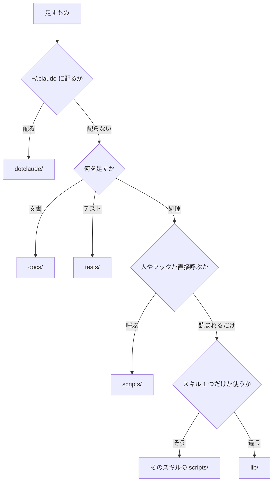

# claude-config を直す時の決まり

> [!NOTE]
> claude-config のフック・スクリプト・スキルを足したり直したりする時の決まりが分かる。
> 確かめ方は [testing.md](testing.md)、部品の一覧は [components.md](components.md) にある。

## 🏷️ 名前の付け方

名前は、頭に `<分類>-` を付けてそろえる。スキル・フック・rules・scripts は、フォルダの中を名前の順に並べると分類ごとにまとまる。分類は、フォルダをまたいで同じ接頭語を使う。

| 対象 | 形 | 例 |
| --- | --- | --- |
| スキル | `<分類>-<すること>` | `pr-create`、`ctx-report` |
| フック | `<分類>-<すること、または名詞>.py` | `docs-check.py`、`pr-gate.py` |
| rules | `<分類>-<範囲>.md`。範囲は、言語・読み手・主題のどれか | `swift-core.md`、`code-comments.md` |
| scripts | `<分類>-<すること、または名詞>.sh`・`.py` | `docs-section.sh`、`config-audit.py` |
| スキルのスクリプト | 動詞を先に、`<すること>[-<対象>]` | `check-listing.py`、`create-worktree.sh` |
| docs/ の文書 | 名詞の kebab-case の `.md`。主題を分ける時は、分けた文書のどれも `<主題>-<分類>.md` にする | `setup.md`、`ios-naming.md`、`ios-architecture.md` |
| lib | 中身の名詞を `snake_case` にし、`.sh` も Python の import で読める形にそろえる。頭は、持ち主が 1 つなら持ち主の名前、複数なら分類の名前にする | `hook_io.py`、`config_audit_names.py`、`build_log.sh` |
| tests/support | 中身の名詞を `snake_case` の `.sh` にする | `assert.sh`、`fixtures.sh` |
| エージェント | 役割の名詞（`-er`） | `explorer` |
| output style | 返す形の名詞 | `report.md` |
| 環境変数 | `CC_[<分類>_]<中身>`。分類は接頭語の表の名前を大文字にする | `CC_UI_DEVICE`、`CC_APPS_DIR` |
| ひな形の印（置き換える所） | `__<名前>__` にし、`replace-placeholders.py` の tokens に入れる | `__App__` |
| ひな形の印（人が書く所） | `<中身>` にする | `<名前>` |
| 外の道具が読むファイル | 道具が決めた名前のままにし、この表の形にしない | `ios/license_plist.yml`、`store-release/templates/ja/*.txt` |

### 並べる順

表と一覧は、次の順に並べる。

| 対象 | 順 |
| --- | --- |
| docs の表と一覧 | 名前の順。手順・段階・重さのように順に意味がある時は、その順 |
| `dotclaude/settings.json` の許可 | コマンドの名前の順。同じコマンドは引数の順 |
| `dotclaude/settings.json` のフック | イベントは処理の順（Pre → Post）、matcher と、その中のフックは名前の順 |

### 接頭語の表

分類は、次の表から選ぶ。表に無い接頭語と使う所に合わない接頭語は、config-audit が `NG` にする。新しい分類が要る時は、行を足してから名前を付ける。

| 接頭語 | 分類 | 使う所 |
| --- | --- | --- |
| `app-` | 企画・立ち上げ | skills |
| `code-` | コード全般 | rules、skills |
| `config-` | claude-config 自体の手入れ | skills、scripts |
| `ctx-` | 文脈とトークンの管理 | skills、hooks |
| `docs-` | 文書 | rules、skills、hooks、scripts |
| `pr-` | PR | skills、hooks |
| `rules-` | rules を読ませる、rules を避けた書き換えを見つける | hooks |
| `shell-` | シェルスクリプト | hooks |
| `store-` | App Store への公開と数字 | skills |
| `swift-` | Swift | rules、hooks |
| `ui-` | 見た目と動きの確認 | skills |

### 動詞の表

スキルのスクリプトの頭の動詞は、次の表から選ぶ。表に無い動詞は config-audit が `NG` にするので、行を足してから名前を付ける。

| 動詞 | すること |
| --- | --- |
| `add`・`create` | 足す、作る |
| `collect` | 手元の記録（会話の記録など）から集める |
| `fetch` | 外（App Store などの API）から取ってくる |
| `find`・`list` | 手元から合うものを 1 つ出す、並べる |
| `search` | 外の API に検索を頼み、合うものを並べる |
| `check`・`classify`・`count`・`hash` | 確かめる、分ける、数える、指紋を取る |
| `record`・`render`・`take`・`tile`・`write` | 録る、描く、撮る、並べる、書く |
| `archive`・`prune`・`replace`・`route`・`run` | アーカイブを作る、片付ける、置き換える、振り分ける、走らせる |
| `send` | 外に送る |

### そろえる語

同じものを指す語は、次の表の左の語にそろえる。右の語は config-audit が `NG` にする。

| 使う語 | 使わない語 |
| --- | --- |
| ワークツリー | 作業場所 |
| commit | コミット |
| スキル | skill |
| 差分の重さ | 確認の重さ |
| そろえる | 揃える |
| 時 | とき |

## 📏 スクリプトの書き方

スクリプトは、読み込まれた時に何も実行せず、結果を同じ形で返す。`make verify` の config-audit が、外れた書き方を `NG` にする。

| 対象 | 決まり |
| --- | --- |
| Python | 処理は `main()` に入れ、末尾を `if __name__ == "__main__":` にする。呼び出しは `run_gate`・`run_hook`・`run_main` で包み、`assert` は使わない |
| シェル | スキルと `scripts/` の `.sh` は、2 行目を `set -euo pipefail` にする。終了コードを受ける所は `\|\| status=$?` で受ける |
| 言語を混ぜない | `.sh`（テストも）の中に `python3 -c` を書かない。JSON は jq で読み、長い処理は `.py` に分ける |
| 結果 | 確かめるスクリプトは、stdout に `OK`・`NG` で始まる行で出す。失敗したら終了コード 1 で終える |
| データを返す | データを返すスクリプトは、成功した時は stdout にデータだけを出す。失敗した時は `NG` の行を出し、終了コード 1 で終える |
| 引数 | 足りない時は `[[ $# -ge N ]]` で確かめ、`NG` を出す。`${N:?}` は使わない |
| 知らせ | スクリプトの、失敗ではない知らせは stderr に出す |
| フック | 終了コード 2 で返す文は stderr に、JSON で返すものは stdout に出す。止めない知らせは、終了コード 0 の stderr が見えないので `notify` で出す |
| 共通の処理 | フックとスクリプトの共通の処理は `lib/` に置き、`sys.path.insert` か `source` で読む。ワークツリーの置き場所は lib にだけ書く |
| フックの登録 | 検査のフックは `if` で拡張子を絞り、当たらないファイルでは起動しない。`Edit(//**/*.md)` は Write に当たらないので、`Write(//**/*.md)` も並べる |
| 編集の matcher | 編集を受けるフックの matcher は、`hook_io` の `FILE_EDIT_TOOLS` と同じ道具を並べる |

## 📦 共通の処理

フック・スクリプト・スキルの入口から読まれる中身は、`lib/` に置く。名前の頭のまとまりとファイルの一覧は、[lib/README.md](../../lib/README.md) にある。

| 決まり | 中身 |
| --- | --- |
| 持ち主が 1 つの中身 | 持ち主の名前を `snake_case` にして頭に付ける。`scripts/docs-section.sh` の中身は `lib/docs_section.py` になる |
| 持ち主が複数の中身 | 分類の名前を頭に付ける。分類をまたぐものは、頭を付けない |
| 一覧 | ファイルを足したら、[lib/README.md](../../lib/README.md) の表に行を足す。載っていないファイルは、config-audit が `NG` にする |

ほかのスキルのスクリプトは、持ち主のスキルに置いたまま、呼ぶ所に合わせた書き方で使う。

| 呼ぶ所 | 書き方 |
| --- | --- |
| スキル | `${CLAUDE_SKILL_DIR}/../<スキル>/scripts/` |
| フック | リポジトリの根からの `dotclaude/skills/<スキル>/scripts/` |

## 📂 フォルダの分け方

最上位は行き先で分け、フォルダの中は平らに並べて名前の頭でまとめる。

足すものの置き場所は、次の順に決める。

| 決まり | 中身 |
| --- | --- |
| 最上位は行き先で分ける | 配るものは `dotclaude/`、読むものは `docs/` に置く。支える仕組みは `lib/`・`scripts/`・`tests/` に置く |
| `dotclaude/` は配る形のまま置く | 中の形は `~/.claude` と同じにする。配る種類が増えたら、`dotclaude/` に足す |
| フォルダの中は平らに並べる | 子フォルダで分けず、[接頭語の表](#接頭語の表) の分類でまとめる |
| 持ち主が 1 つのものは持ち主の下に置く | そのスキルだけが呼ぶスクリプトは `dotclaude/skills/<名前>/scripts/` に置く |
| ひな形は単位で分ける | `dotclaude/skills/<名前>/templates/<単位>/` に置く。単位は、アプリ 1 本・言語・セットのどれか |
| `scripts/` には入口だけを置く | 人・フック・複数のスキルが呼ぶ共通の道具の入口を置く。入口が読む `.py`・`.jq` は、`lib/` に置く |
| `dotclaude/hooks/` は `.py` と `run.sh` だけにする | `.py` 以外は `run.sh` だけを置く。イベントは `dotclaude/settings.json` に書く |
| 文書は読む時で分ける | アプリの文書は `docs/app/`、claude-config の文書は `docs/config/` に置く |

数が増えた時は、次の合図で分ける。

| 場所 | 合図 | 分け方 |
| --- | --- | --- |
| `lib/` | 同じ持ち主か、同じ分類の頭のファイルが 8 本を超える | その頭だけを子フォルダにする |
| `tests/` | テストが 50 本を超える | 接頭語ごとの子フォルダにする |
| `docs/app/` | iOS のほかのアプリの文書が加わる | `<機体>-<主題>.md` の名前で並べる |

## 🪜 足し方

1. 名前の頭を [接頭語の表](#接頭語の表) で確かめる。スキルのスクリプトは、頭の動詞を [動詞の表](#動詞の表) で確かめる。
2. 本体を置く。スキルは `dotclaude/skills/<名前>/SKILL.md` に置く。フックは `dotclaude/hooks/<名前>.py`、スクリプトは `scripts/` に置く。
3. lib に足した時は、[lib/README.md](../../lib/README.md) の表に行を足す。
4. フックは、`dotclaude/settings.json` にも登録する。書き方は [スクリプトの書き方](#-スクリプトの書き方) の表にある。
5. `tests/<名前>.sh` を足し、[tests/README.md](../../tests/README.md) の表に行を足す。
6. [components.md](components.md) か [skills.md](skills.md) の表に行を足す。スキルは、skills.md の使う順の図にも足す。
7. 文書を足したり書き換えたりする時は、[docs-core](../../dotclaude/rules/docs-core.md)・[docs-human](../../dotclaude/rules/docs-human.md)・[docs-app](../../dotclaude/rules/docs-app.md) の決まりに従う。
8. [testing.md](testing.md#-動かし方) の `make verify` を通す。
