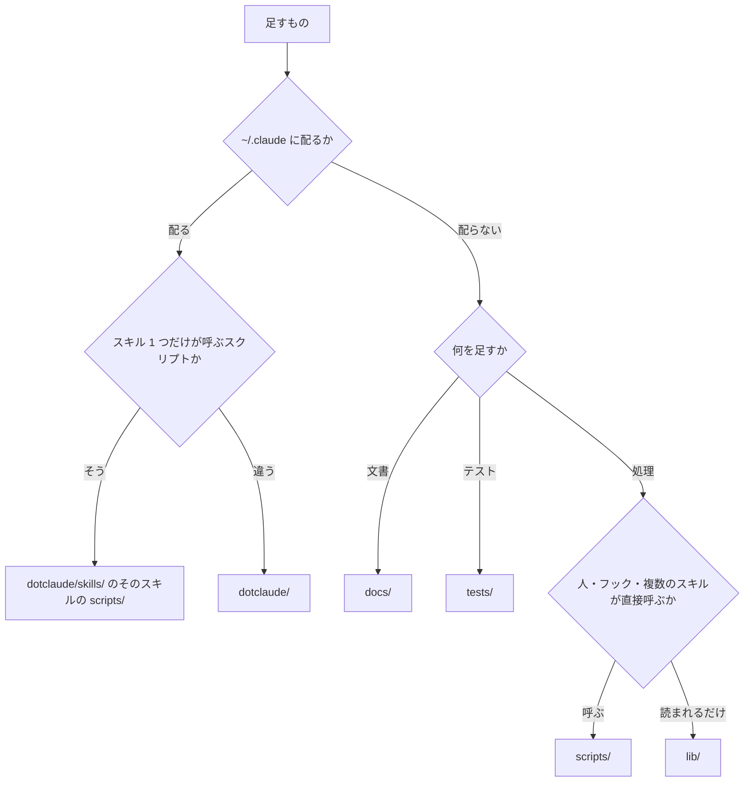

# claude-config の置き場所

> [!NOTE]
> claude-config のファイルを置ける場所と、数が増えた時の分け方が分かる。
> 名前の付け方と足し方は [development.md](development.md) にある。

## 📂 フォルダの分け方

最上位は行き先で分け、フォルダの中は平らに並べて名前の頭でまとめる。

足すものの置き場所は、次の順に決める。

| 決まり | 中身 |
| --- | --- |
| 最上位は行き先で分ける | 配るものは `dotclaude/`、読むものは `docs/` に置く。支える仕組みは `lib/`・`scripts/`・`tests/` に置く |
| `dotclaude/` は配る形のまま置く | 中の形は `~/.claude` と同じにする。配る種類が増えたら、`dotclaude/` に足す |
| フォルダの中は平らに並べる | 子フォルダで分けず、[接頭語の表](development.md#接頭語の表) の分類でまとめる。`lib/` の持ち主の子フォルダだけを除く |
| 置ける場所は表で決める | 追跡するファイルは、[置ける場所の表](#置ける場所の表) のどれかの行に当てる |
| 持ち主が 1 つのものは持ち主の下に置く | そのスキルだけが呼ぶスクリプトは `dotclaude/skills/<名前>/scripts/` に置く |
| ひな形は単位で分ける | `dotclaude/skills/<名前>/templates/<単位>/` に置く。単位は、アプリ 1 本・言語・セットのどれか |
| `scripts/` には入口だけを置く | 人・フック・複数のスキルが呼ぶ共通の道具の入口を置く。入口が読む `.py`・`.jq` は、`lib/` に置く |
| `dotclaude/hooks/` は `.py` と `run.sh` だけにする | `.py` 以外は `run.sh` だけを置く。イベントは `dotclaude/settings.json` に書く |
| 文書は読む時で分ける | アプリの文書は `docs/app/`、claude-config の文書は `docs/config/` に置く |

### 置ける場所の表

追跡するファイルは、次の表の場所にだけ置く。どの行にも当たらないファイルと、当たるファイルの無い行は、config-audit が `NG` にする。

| 場所 | 置くもの |
| --- | --- |
| `.gitignore`・`CLAUDE.md`・`Makefile`・`README.md` | リポジトリの根のファイル |
| `docs/app/*.md` | アプリの共通の文書 |
| `docs/config/*.md` | claude-config の文書 |
| `docs/images/*.svg` | 文書の画像 |
| `dotclaude/CLAUDE.md`・`dotclaude/settings.json` | 共通の決まりと、フックと許可の登録 |
| `dotclaude/agents/*.md` | エージェント |
| `dotclaude/hooks/*.py`・`dotclaude/hooks/run.sh` | フックと、フックの入口 |
| `dotclaude/output-styles/*.md` | output style |
| `dotclaude/rules/*.md` | rules |
| `dotclaude/skills/*/SKILL.md` | スキル |
| `dotclaude/skills/*/scripts/*` | スキルのスクリプト |
| `dotclaude/skills/*/templates/**` | スキルのひな形 |
| `lib/README.md`・`lib/*.jq`・`lib/*.py`・`lib/*.sh` | 共通の処理と、その一覧 |
| `lib/*/*.py` | 持ち主が 1 つの中身 |
| `scripts/*.py`・`scripts/*.sh` | スクリプトの入口 |
| `tests/README.md`・`tests/*.sh` | テストと、その一覧 |
| `tests/support/*.sh` | テストの共通の処理 |

場所は、`/` で区切った段ごとに照らす。`*` は 1 段の中の文字に当たり、末尾の `**` はその下の全部に当たる。

`dotclaude/` の最上位に種類を足す時は、`scripts/config-install.sh` に入れる処理も足す。入れる処理の無い種類は、config-audit が `NG` にする。

### 分ける合図の表

数が次の表の上限を超えたら、config-audit が `NG` にする。当たるファイルの無い行も `NG` にする。分けた時は、同じ commit で 2 つの表の場所を直す。

| 場所 | 数えるもの | 上限 | 超えた時の分け方 |
| --- | --- | --- | --- |
| `dotclaude/hooks/*.py` | 同じ頭 | 6 | 接頭語を割り、接頭語の表に行を足す |
| `dotclaude/skills/*/SKILL.md` | 同じ頭 | 6 | 接頭語を割り、接頭語の表に行を足す |
| `lib/*` | 同じ頭 | 8 | 中身を分類で割り、頭を分ける |
| `scripts/*` | 全部 | 10 | 接頭語ごとの子フォルダにする |
| `tests/*.sh` | 全部 | 50 | 接頭語ごとの子フォルダにする |

「同じ頭」は、名前の最初の `-`・`_`・`.` より前が同じものをまとめて数える。スキルは、フォルダの名前で数える。

`docs/app/` に iOS のほかのアプリの文書が加わる時は、`<機体>-<主題>.md` の名前で並べる。
