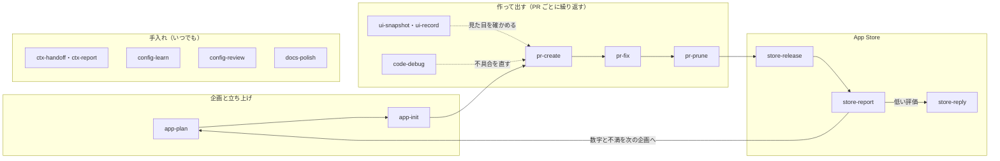

# スキル

> [!NOTE]
> どのスキルを、どの順に、誰が呼ぶかが分かる。
> フックやエージェントは [components.md](components.md) にある。

## 🗓️ 使う順

スキルは、Claude が要る時に自分で呼ぶ。人は `/<スキル>` で呼ぶ。名前の頭が分類を表す。

アプリの企画から公開の後まで、次の順に使う。手入れのスキルは、どの段でも使う。

## 🧰 一覧

呼ぶ人は、絵文字で分ける。

> [!IMPORTANT]
> pr-create・store-release・store-reply は外に出す操作を含む。人が言葉で頼んだ時だけ呼び、外に出す前に承認を得る。

| 段 | スキル | 呼ぶ人 | すること |
| --- | --- | --- | --- |
| 企画と立ち上げ | [app-plan](../skills/app-plan/SKILL.md) | 🤝 人と Claude | 競合のレビューの不満を集め、overview と roadmap の下書きを作る |
| 企画と立ち上げ | [app-init](../skills/app-init/SKILL.md) | 🤝 人と Claude | ひな形から、ビルドとテストが通るアプリのリポジトリを作る |
| 作って出す | [ui-snapshot](../skills/ui-snapshot/SKILL.md) | 🧠 Claude だけ | SwiftUI の画面をテストとして描き、場合ごとの PNG にする |
| 作って出す | [ui-record](../skills/ui-record/SKILL.md) | 🧠 Claude だけ | シミュレーターを録画し、確かめたい場面のコマを並べる |
| 作って出す | [code-debug](../skills/code-debug/SKILL.md) | 🤝 人と Claude | 再現・3 つの仮説・検証で原因を確かめ、承認された直し方と再現テストを入れる |
| 作って出す | [pr-create](../skills/pr-create/SKILL.md) | 🙋 人が頼んだ時だけ | 差分の大きさに合わせた確認とレビューを通して PR を作る |
| 作って出す | [pr-fix](../skills/pr-fix/SKILL.md) | 🤝 人と Claude | 落ちた CI と未解決の指摘を直し、push し直す |
| 作って出す | [pr-prune](../skills/pr-prune/SKILL.md) | 🤝 人と Claude | マージされた PR を main に反映し、ワークツリーを片付ける |
| App Store | [store-release](../skills/store-release/SKILL.md) | 🙋 人が頼んだ時だけ | 申告・掲載情報・スクリーンショットを確かめ、アーカイブを送る。カスタムプロダクトページを作る |
| App Store | [store-report](../skills/store-report/SKILL.md) | 🤝 人と Claude | 全アプリの月ごとのダウンロード・収益・評価を表にする |
| App Store | [store-reply](../skills/store-reply/SKILL.md) | 🙋 人が頼んだ時だけ | 返信していない低い評価のレビューに返信案を書き、承認された案を送る |
| 手入れ | [ctx-handoff](../skills/ctx-handoff/SKILL.md) | 🤝 人と Claude | 区切る前に、続きに要ることを `.claude/handoff.md` に書く |
| 手入れ | [ctx-report](../skills/ctx-report/SKILL.md) | 🤝 人と Claude | 月ごとに、トークンを多く使った作業を表にする |
| 手入れ | [config-learn](../skills/config-learn/SKILL.md) | 🤝 人と Claude | 繰り返した手直しとフックの回数から、決まりの改定案を出す |
| 手入れ | [config-review](../skills/config-review/SKILL.md) | 🤝 人と Claude | claude-config を観点ごとに調べ、台帳に無い改善だけを出す |
| 手入れ | [docs-polish](../skills/docs-polish/SKILL.md) | 🤝 人と Claude | 文字だけが続く節を見つけ、表・図・絵文字で見やすくする案を見本付きで出す |
