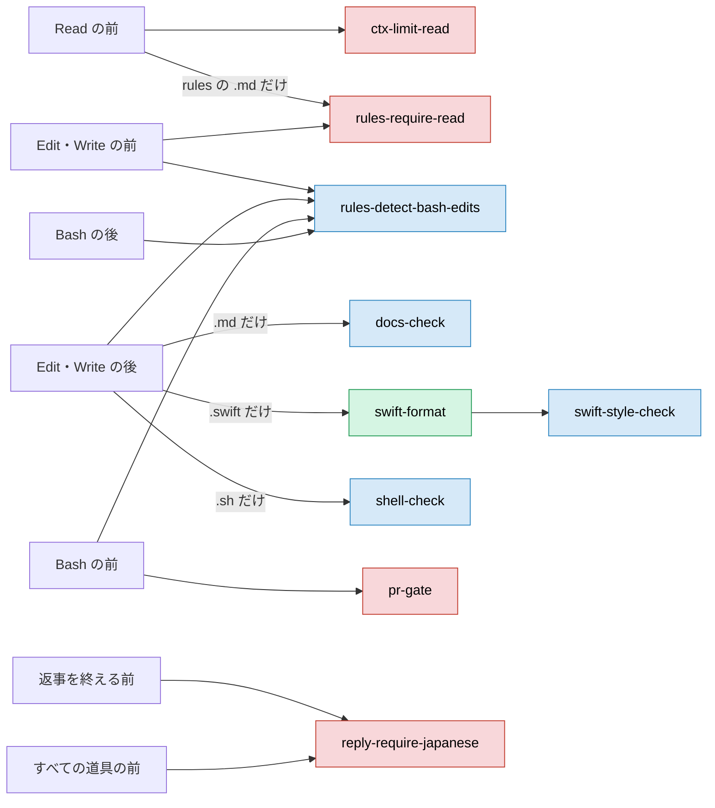

# 部品

> [!NOTE]
> claude-config の部品が、それぞれいつ動き、何をするかが分かる。
> スキルは [skills.md](skills.md)、入れ方は [setup.md](setup.md) にある。

## 📏 決まり

CLAUDE.md はいつも読み込まれる。rules は、当たるファイルを読み書きする時だけ読み込まれる。足して読む元がある rules は、元の rules と一緒に読み込まれる。

| ファイル | 読み込まれる時 | 足して読む元 | 決めること |
| --- | --- | --- | --- |
| [CLAUDE.md](../../dotclaude/CLAUDE.md) | いつも | | 言語、進め方、使う量、報告、ブランチ・commit・PR |
| [dotclaude/output-styles/report.md](../../dotclaude/output-styles/report.md) | いつも。config-install.sh が `outputStyle` に入れる | | 結論を先に書き、表と状態の印で組む日本語の報告の形 |
| [dotclaude/rules/code-comments.md](../../dotclaude/rules/code-comments.md) | Swift・Kotlin・設定・シェル | | コメントを書かない |
| [dotclaude/rules/docs-app.md](../../dotclaude/rules/docs-app.md) | `docs/`・`spec/`・README・CLAUDE.md | docs-core | アプリの文書ごとの役割と、足す条件 |
| [dotclaude/rules/docs-claude.md](../../dotclaude/rules/docs-claude.md) | CLAUDE.md・rules・SKILL.md・agents | docs-core | 飾らない形と、節の並び |
| [dotclaude/rules/docs-core.md](../../dotclaude/rules/docs-core.md) | `.md` | | 運用、文、表現、守らせる仕組み |
| [dotclaude/rules/docs-human.md](../../dotclaude/rules/docs-human.md) | README・`docs/`・`spec/` | docs-core | 冒頭、見出しの絵文字、技術のアイコン、README の形 |
| [dotclaude/rules/swift-core.md](../../dotclaude/rules/swift-core.md) | Swift | | 宣言の置き方、改行、空行、ファイル |
| [dotclaude/rules/swift-test.md](../../dotclaude/rules/swift-test.md) | `Tests/`・`<名前>Tests/` の Swift | swift-core | テストの空行と型の置き方 |
| [dotclaude/rules/swift-ui.md](../../dotclaude/rules/swift-ui.md) | 画面と部品のフォルダ、`*View.swift` | swift-core | `View` の分け方、ビューの並べ方 |

## 🪝 フック

フックは、決まりを守らせるために、止める・知らせる・整えるのどれかをする。どれも [run.sh](../../dotclaude/hooks/run.sh) が名前で受け、同じフォルダの `<名前>.py` を `python3 -I` で走らせる。

図の色は、表の動きの印に合わせる。赤は 🛑 止める、青は 💬 知らせる、緑は 🧹 整える。



| フック | 動き | 呼ばれる時 | 動く条件 |
| --- | --- | --- | --- |
| [ctx-limit-read](../../dotclaude/hooks/ctx-limit-read.py) | 🛑 止める | Read の前 | 30KB を超えるテキストを、`limit` を付けずに読む時 |
| [docs-check](../../dotclaude/hooks/docs-check.py) | 💬 知らせる | `.md` を Edit・Write した後。メモリのファイルは見ない | `.md` が `dotclaude/rules/docs-*.md` に合わない時 |
| [pr-gate](../../dotclaude/hooks/pr-gate.py) | 🛑 止める | Bash の前 | pr-create の `run-check.sh` の確認の前に、push や `gh pr create` をする時。cd と `git -C` の先が変数でも止める |
| [reply-require-japanese](../../dotclaude/hooks/reply-require-japanese.py) | 🛑 止める | 返事を終える前（Stop）と、すべての道具の前 | 返事の地の文が、コードと URL を除いて英語の時。道具の前では今のターンの一つ前の一言を見て、同じ一言では二度止めない |
| [rules-detect-bash-edits](../../dotclaude/hooks/rules-detect-bash-edits.py) | 💬 知らせる | Bash と Edit・Write の前と後 | Bash でファイルを書き換えた時。git は checkout など、gh・cd は出力の向け先だけを見て、make などの道具は NG の行だけ返す |
| [rules-require-read](../../dotclaude/hooks/rules-require-read.py) | 🛑 止める | rules の `.md` の Read と、Edit・Write の前 | 当たる rules を、この会話でまだ読まずに編集する時 |
| [shell-check](../../dotclaude/hooks/shell-check.py) | 💬 知らせる | `.sh` を Edit・Write した後 | `.sh` の `bash -n` と、変数の直後の全角 |
| [swift-format](../../dotclaude/hooks/swift-format.py) | 🧹 整える | `.swift` を Edit・Write した後。`.swiftformat` が無ければ動かない | `.swift` を、Mintfile の swiftformat で整える |
| [swift-style-check](../../dotclaude/hooks/swift-style-check.py) | 💬 知らせる | `.swift` を Edit・Write した後。swift-format の後に順に走る | `.swift` が、整形で直らない `dotclaude/rules/swift-*.md` の改行と空行に合わない時 |

### 例外で落ちた時

pr-gate と rules-require-read は、フック自体が落ちた時の動きが決まっている。

> [!IMPORTANT]
> pr-gate と rules-require-read は、フックが想定外の例外で落ちた時も止める。pr-gate は、run-check.sh を走らせられなかった時も止める。時間切れもこれに含む。

ほかのフックは、想定外の例外を知らせて通す。

### フックを無効にする

フックを無効にする時は、[環境変数](#-環境変数)の `CC_HOOKS_OFF` に名前を並べる。

> [!WARNING]
> `CC_HOOKS_OFF` に pr-gate を並べると、PR を出す前の確認の門も外れる。

```sh
CC_HOOKS_OFF="pr-gate,rules-require-read" claude
```

## 👷 エージェント

エージェントは、仕事の重さに合わせてモデルを分ける。

| エージェント | モデル | 呼ぶ所 | 任せること |
| --- | --- | --- | --- |
| [debugger](../../dotclaude/agents/debugger.md) | Opus | code-debug、CLAUDE.md の「任せる」 | 仮説ごとに裏付けと反証を集めて返す。書き換えない |
| [explorer](../../dotclaude/agents/explorer.md) | Haiku | CLAUDE.md の「任せる」 | 場所と事実を探して短く返す。書き換えない |
| [implementer](../../dotclaude/agents/implementer.md) | Sonnet | CLAUDE.md の「任せる」と「並べる」 | 方針の決まった実装、削除、名前の変更、文書の書き換え |
| [reviewer](../../dotclaude/agents/reviewer.md) | Opus | pr-create | 差分を読み、マージすると困る所を 5 件まで返す |
| [tester](../../dotclaude/agents/tester.md) | Sonnet | code-debug、CLAUDE.md の「任せる」 | 正常・異常・境界のテストを書いて通す。本体は直さない |

## 📜 スクリプト

入れる時、確かめる時、文書を読む時に、次のスクリプトを使う。

| スクリプト | 呼ぶ時 | すること |
| --- | --- | --- |
| [bin/config-audit.py](../../bin/config-audit.py) | `make audit` の時 | 部品の文書の表・図・参照先と名前の食い違い、置き場所、文書とスクリプトの書き方の違反を見る。引数に検査の名前を並べると、その検査だけを走らせる |
| [bin/config-install.sh](../../bin/config-install.sh) | 入れる時 | `~/.claude` からリンクを張り、settings.json の案を作る |
| [bin/docs-section.sh](../../bin/docs-section.sh) | 文書を読む時 | 見出しの一覧か、指定した節だけを出す |
| [bin/docs-tech-icons.py](../../bin/docs-tech-icons.py) | README の技術のアイコンを作る時 | Simple Icons のロゴを取り、アイコンを並べた SVG を書く |

## 🔧 環境変数

フックとスクリプトの動きは、次の環境変数で変えられる。claude-config だけの変数は、`CC_` と分類で始める。表に無い `CC_` の変数と、どこも読まない行は、config-audit が `NG` にする。

| 変数 | 使う所 | 中身 |
| --- | --- | --- |
| `ASC_ISSUER_ID` ほか `ASC_*` | store-reply、store-report | App Store Connect API のキー |
| `CC_APPS_DIR` | app-init、store-reply、store-report | アプリのリポジトリの置き場所 |
| `CC_REPORTS_DIR` | store-report | 月ごとの表の置き場所 |
| `CC_HOOKS_OFF` | dotclaude/hooks/run.sh、rules-detect-bash-edits | 空白・改行・タブ・カンマで区切った名前のフックを動かさない。dotclaude/hooks/ に無い名前は stderr に出す（デバッグのログでだけ見える） |
| `CC_PROJECTS_DIR` | config-learn、ctx-report | 会話の記録の置き場所 |
| `CC_STORE_ARCHIVE_ONLY`・`CC_STORE_EXPORT` | store-release | 前の変数。付いていれば、送らずに `NG` で止まる |
| `CC_STORE_DESTINATION` | store-release | アーカイブの行き先。`upload`（既定）は送り、`export` は IPA を書き出し、`archive` はアーカイブだけを作る |
| `CC_UI_DEVICE` | ui-snapshot | 描くシミュレーターの UDID |
| `CC_UI_WORK_DIR` | ui-snapshot | 描く時の写しを置くフォルダ。既定は `~/Library/Caches/ui-snapshot` |
