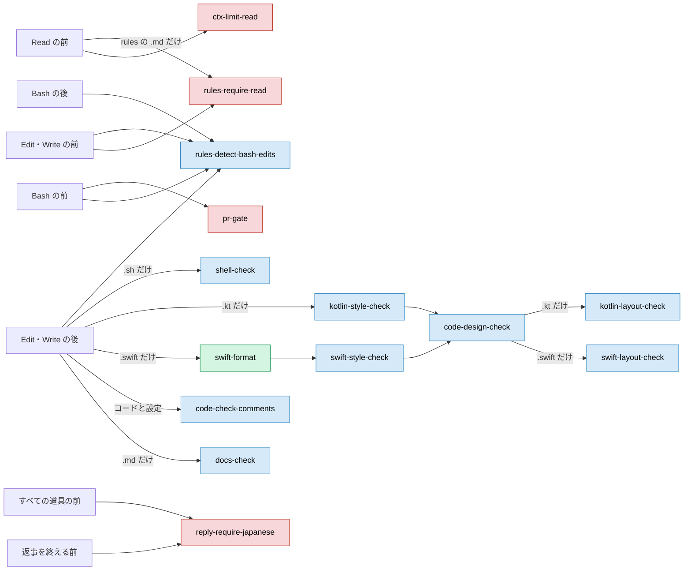

# フック

> [!NOTE]
> claude-config のフックが、いつ呼ばれ、何を止め、何を知らせるかが分かる。
> ほかの部品は [components.md](components.md)、スキルは [skills.md](skills.md) にある。

## 🪝 呼ばれる時と動き

フックは、決まりを守らせるために、止める・知らせる・整えるのどれかをする。どれも [run.sh](../../dotclaude/hooks/run.sh) が名前で受け、同じフォルダの `<名前>.py` を `python3 -I` で走らせる。

図の色は、表の動きの印に合わせる。赤は 🛑 止める、青は 💬 知らせる、緑は 🧹 整える。



| フック | 動き | 呼ばれる時 | 動く条件 |
| --- | --- | --- | --- |
| [code-check-comments](../../dotclaude/hooks/code-check-comments.py) | 💬 知らせる | コードと設定のファイルを Edit・Write した後 | `dotclaude/rules/code-comments.md` で残すものを除き、コメントがある時 |
| [code-design-check](../../dotclaude/hooks/code-design-check.py) | 💬 知らせる | `.swift` と `.kt` を Edit・Write した後。swift-style-check か kotlin-style-check の後に順に走る | `dotclaude/rules/code-design.md` の、数で分かる決まりに合わない時。大きさ・名前・状態の数・モデルの形・画面の形・同じ形を見て、アプリの基準線にある外れは通す |
| [ctx-limit-read](../../dotclaude/hooks/ctx-limit-read.py) | 🛑 止める | Read の前 | 30KB を超えるテキストを、`limit` を付けずに読む時 |
| [docs-check](../../dotclaude/hooks/docs-check.py) | 💬 知らせる | `.md` を Edit・Write した後。メモリのファイルは見ない | `.md` が `dotclaude/rules/docs-*.md` に合わない時。「の」の続きと大きさの外れは、止めずに知らせる |
| [kotlin-layout-check](../../dotclaude/hooks/kotlin-layout-check.py) | 💬 知らせる | `.kt` を Edit・Write した後。code-design-check の後に順に走る | `dotclaude/rules/kotlin-layout.md` の決まりに合わない時。区画・入れ子の深さ・空行・関数の長さ・Composable の本体の順を見て、基準線にある外れは通す |
| [kotlin-style-check](../../dotclaude/hooks/kotlin-style-check.py) | 💬 知らせる | `.kt` を Edit・Write した後 | `.kt` が、整形で直らない `dotclaude/rules/kotlin-*.md` の空行に合わない時 |
| [pr-gate](../../dotclaude/hooks/pr-gate.py) | 🛑 止める | Bash の前 | pr-create の `run-check.sh` の確認の前に、push や `gh pr create` をする時。cd と `git -C` の先が変数でも止める |
| [reply-require-japanese](../../dotclaude/hooks/reply-require-japanese.py) | 🛑 止める | 返事を終える前（Stop）と、すべての道具の前 | 返事の地の文が、コードと URL を除いて英語の時。道具の前では今のターンの一つ前の一言を見て、同じ一言では二度止めない |
| [rules-detect-bash-edits](../../dotclaude/hooks/rules-detect-bash-edits.py) | 💬 知らせる | Bash と Edit・Write の前と後 | Bash でファイルを書き換えた時。git は checkout など、gh・cd は出力の向け先だけを見て、make などの道具は NG の行だけ返す |
| [rules-require-read](../../dotclaude/hooks/rules-require-read.py) | 🛑 止める | rules の `.md` の Read と、Edit・Write の前 | 当たる rules を、この会話でまだ読まずに編集する時 |
| [shell-check](../../dotclaude/hooks/shell-check.py) | 💬 知らせる | `.sh` を Edit・Write した後 | `.sh` の `bash -n` と、変数の直後の全角 |
| [swift-format](../../dotclaude/hooks/swift-format.py) | 🧹 整える | `.swift` を Edit・Write した後。`.swiftformat` が無ければ動かない | `.swift` を、Mintfile の swiftformat で整える |
| [swift-layout-check](../../dotclaude/hooks/swift-layout-check.py) | 💬 知らせる | `.swift` を Edit・Write した後。code-design-check の後に順に走る | `dotclaude/rules/swift-layout.md` の決まりに合わない時。ファイルの区画・extension の役割・型の本体・宣言と文の空行・関数の長さを見て、アプリの基準線にある外れは通す |
| [swift-style-check](../../dotclaude/hooks/swift-style-check.py) | 💬 知らせる | `.swift` を Edit・Write した後。swift-format の後に順に走る | `.swift` が、整形で直らない `dotclaude/rules/swift-*.md` の決まりに合わない時。改行・空行・`else if` の条件の数を見る |

### 返事の言葉を見る範囲

reply-require-japanese は、会話の記録に残った一言だけを見る。道具の前に書いた一言は記録に残らないことがあり、その一言は止められない。道具の前の判定は一歩遅れるので、止めた時の文に、止めた一言の書き出しを引く。

### 例外で落ちた時

pr-gate と rules-require-read は、フック自体が落ちた時の動きが決まっている。

> [!IMPORTANT]
> pr-gate と rules-require-read は、フックが想定外の例外で落ちた時も止める。pr-gate は、run-check.sh を走らせられなかった時も止める。時間切れもこれに含む。

ほかのフックは、想定外の例外を知らせて通す。

### フックを無効にする

フックを無効にする時は、[環境変数](components.md#-環境変数)の `CC_HOOKS_OFF` に名前を並べる。

> [!WARNING]
> `CC_HOOKS_OFF` に pr-gate を並べると、PR を出す前の確認の門も外れる。

```sh
CC_HOOKS_OFF="pr-gate,rules-require-read" claude
```
