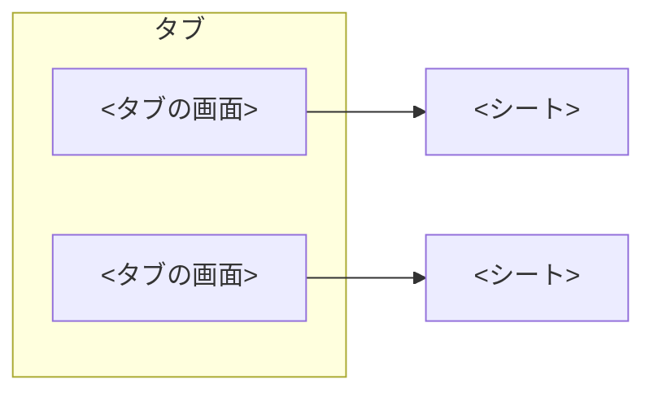

# 画面と作る順番

> [!NOTE]
> <名前> を作る順番と、その状態、作る画面、この先の段階と収益化が分かる。
> 最初のリリースの機能は [overview](overview.md) にある。

## 🗓️ 作る順番

状態は ✅ 完了、🚧 作業中、⬜ 未着手で書く。

| 順 | 中身 | OS | 状態 |
| --- | --- | --- | --- |
| 0 | 土台 | 🍎 iOS | ⬜ 未着手 |
| 1 | <最初に毎日使い始められる形> | 🍎 iOS | ⬜ 未着手 |
| <公開の番号> | ストアの準備と公開 | 🍎 iOS | ⬜ 未着手 |

## 💰 この先の段階と収益化

最初のリリースの後に、足していく機能と収益の形を並べる。

| 段階 | 機能 | 収益 |
| --- | --- | --- |
| 最初のリリース | [overview](overview.md#-最初のリリースの機能) の表 | <無料か、課金の形> |
| 次の更新 | <機能> | <収益> |

## 📱 画面

画面は、タブと、そこから開くシートに分かれる。

| 画面 | 中身 |
| --- | --- |
| <画面> | <中身> |
