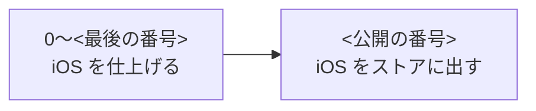

# 画面と作る順番

<名前> を作る順番と、その状態、作る画面を書く。

## 作る順番

作る順番は、大きく次の段階に分かれる。

| 順 | 中身 | OS | 状態 |
| --- | --- | --- | --- |
| 0 | 土台 | iOS | ⬜ 未着手 |
| 1 | <最初に毎日使い始められる形> | iOS | ⬜ 未着手 |
| <公開の番号> | ストアの準備と公開 | iOS | ⬜ 未着手 |

## 画面

画面は、タブと、そこから開くシートに分かれる。

| 画面 | 中身 |
| --- | --- |
| <画面> | <中身> |
